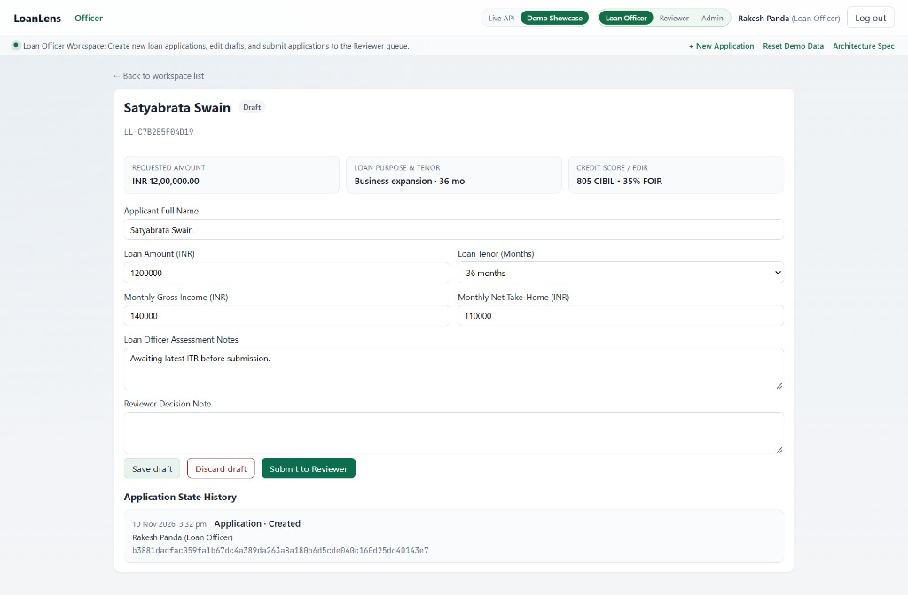
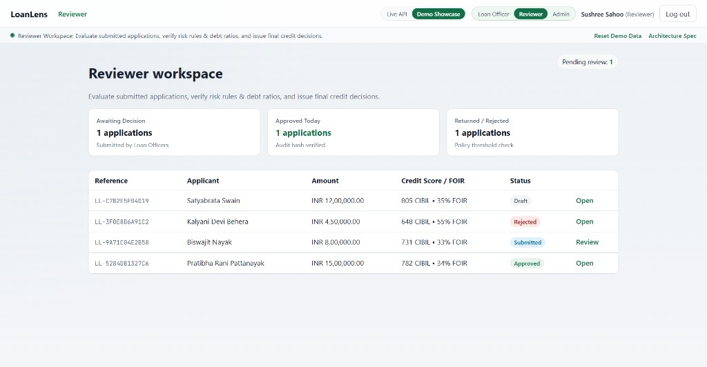
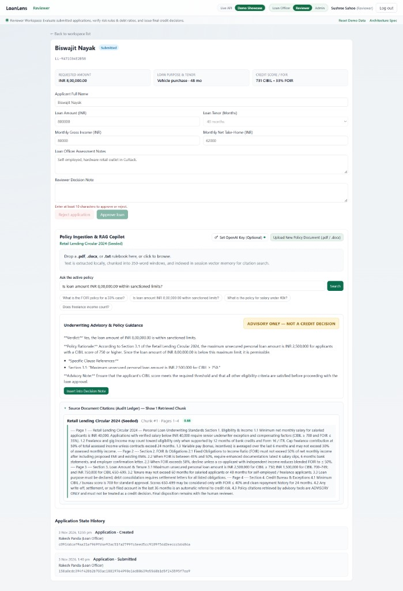
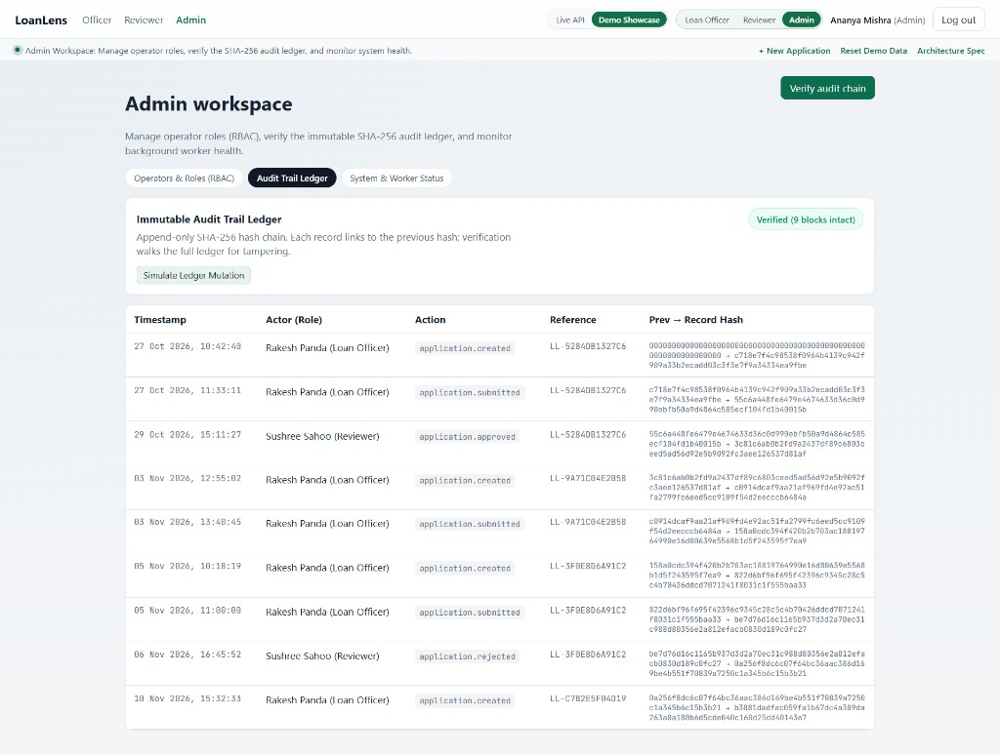

# LoanLens

[](https://loan-lens.vercel.app)
[](https://www.typescriptlang.org/)
[](https://react.dev/)
[](https://fastapi.tiangolo.com/)
[]()

**Live demo:** [https://loan-lens.vercel.app](https://loan-lens.vercel.app)

> 📄 **Formal Architecture Spec:** Review the [Architecture Decision Records (ADRs 001–008)](./docs/LoanLens_Architectural_Decision_Records.pdf) covering regulatory compliance, Maker-Checker state machine, tamper-evident SHA-256 ledger mechanics, and deterministic credit math.

Retail loan verification and underwriting support. LoanLens gives a lending desk a maker-checker workflow, deterministic credit math, a tamper-evident audit ledger, and an advisory policy copilot. Officers originate applications. Reviewers decide them. Admins govern roles and prove the ledger. No language model computes an instalment, a ratio, or a pass/fail gate.

The public site runs **Standalone Showcase** mode: a browser-only dataset with the same screens, rules, and hash chain as the local SPA. The repository also ships a **full stack** — FastAPI, a PostgreSQL-backed worker, and PostgreSQL 16 — for sessions, uploads, and durable workflow runs.

---

## Architectural pillars

### 1. Maker-checker RBAC

Three roles, and no role both originates and decides a case.

| Role | Demo operator | What they can do |
|---|---|---|
| Loan Officer | Rakesh Panda (`rakesh.panda@loanlens.demo`) | Create and edit drafts, discard a draft, submit to the reviewer queue |
| Reviewer | Sushree Sahoo (`sushree.sahoo@loanlens.demo`) | Read the queue, verify ratios, record **Approved** or **Rejected** |
| Admin | Ananya Mishra (`ananya.mishra@loanlens.demo`) | Govern operators, verify the audit chain, monitor worker health. In demo mode, also switch into the other two workspaces |

Authorization is a server (and demo-engine) check, re-validated on review writes. Hiding a button is not the gate. Status moves are ordered: a draft can be saved, discarded, or submitted; only a **Submitted** case can be approved or rejected; a completed case stays on the record. Out-of-order moves fail with a structured error (`code`, `message`, `details`, `request_id`).

In Demo Showcase, the top bar **role simulator** switches persona without a password. **Log out** opens the same account picker. **Live API** uses an HttpOnly session instead, and the simulator is hidden.

### 2. Deterministic credit math

EMI, FOIR, and verification rules BR-01 through BR-11 are pure functions. The backend engine (`modules/calculations/engine.py`, formula `standard_amortizing_emi_v1`) uses `Decimal` with half-up rounding. The SPA previews the same formula so the screen updates as the officer types. The persisted backend result is the figure a decision is replayed against.

- **Tenor.** Intake offers 12, 24, 36, 48, or 60 months. The default is 36. Proposed EMI is the standard amortizing payment at 10.5% annual (zero-rate loans divide principal by tenor).
- **Gross and net stay separate.** Monthly gross income is captured for assessment. Monthly net take-home is the only FOIR divisor. Gross is never substituted for net.
- **FOIR.** Fixed Obligations to Income Ratio is `(existing monthly EMIs + proposed EMI) / net monthly take-home`. The default ceiling is 50%. A result at or under the ceiling passes. Zero net income with any obligation saturates the ratio at 999.99% and fails the gate. Net disposable income is take-home minus total obligations.

Changing amount, tenor, or net take-home recalculates **Credit Score / FOIR** on the application page immediately. Inputs, formula identity, and rule version are stored with the assessment so a later reader can replay the number. Model text cannot overwrite it.

### 3. Tamper-evident audit ledger

Every material action appends one audit event. The event stores a SHA-256 digest of its canonical content (`previous hash`, timestamp, actor, action, reference) and the hash of the preceding event. The chain starts at a genesis hash of 64 zeroes. Appends are serialized, so two writers cannot fork the log.

Verification walks the chain from genesis and stops at the first broken link or content hash. **Discard draft** soft-archives a draft: status becomes `Discarded`, a `DRAFT_DISCARDED` event is appended, and the row stays in the list. Completed applications cannot be deleted; the detail page says so.

Demo Showcase runs the same chain in the browser with Web Crypto. On **Admin → Audit Trail Ledger**:

- **Verify audit chain** replays every block and reports how many are intact.
- **Simulate Ledger Mutation** rewrites a mid-chain block (index 2) with a foreign actor and a fake hash. Verification then fails at that block.
- **Repair Ledger** rebuilds previous-hash links and recomputes SHA-256 digests, then verifies the restored chain.

The simulator is a showcase control. It does not exist as a production write path.

### 4. Advisory policy RAG copilot

Reviewers and admins get a **Policy Ingestion & RAG Copilot** on the application page. It answers policy questions. It does not approve or decline.

- **Ingestion** runs in the browser. PDF text is read with PDF.js, DOCX with Mammoth, and `.txt` directly. Nothing in that pipeline is sent to a server unless an optional completion call is enabled.
- **Chunking** uses a sliding window of 350 words with a 50-word overlap. A fresh upload replaces the in-session index. Until then, the seeded *Retail Lending Circular 2024* is active (salary floor, 50% FOIR, amount bands, 60-month salaried tenor cap, bureau floor, and an explicit advisory-only clause).
- **Retrieval** scores chunks by term frequency and presents the score on a 0–1 pseudo-cosine scale. The top three hits above the relevance floor are kept.
- **Synthesis** writes a short underwriting note: verdict, rationale, and clause citations. With an OpenAI key the call uses `gpt-4o-mini`. With no key, a fluent local advisory is built from the retrieved clauses. Raw chunk text is not the answer.
- **Audit of retrieval.** **Source Document Citations (Audit Ledger)** is collapsed by default. Opening it shows each chunk’s document, page or section label, chunk number, score, and text.
- **Optional key.** **Set OpenAI Key (Optional)** stores the key in `sessionStorage` for the browser tab only (or reads `VITE_OPENAI_API_KEY` when set at build time). Clearing the key returns the copilot to the local advisory. **Insert into Decision Note** copies the advisory into the reviewer note; the reviewer still types or keeps at least 10 characters and presses **Approve loan** or **Reject application** themselves.

Every advisory surface carries **ADVISORY ONLY — NOT A CREDIT DECISION** (BR-12). Observations stay labelled model output. They are not findings and they are not the disposition.

---

## Evaluator tour (Demo Showcase)

Use the [live demo](https://loan-lens.vercel.app) or the local SPA (next section). No API account is required.

1. Open the app. On the sign-in card, choose **Open Demo Showcase**.
2. Confirm the header pill reads **Demo Showcase** (pulsing status dot) and the badge reads **Rakesh Panda (Loan Officer)**.
3. If a previous session left the dataset dirty, choose **Reset Demo Data** in the context bar. The seeded cases return and the current persona stays.

Seeded cases you will meet:

| Reference | Applicant | Status | Why it is useful |
|---|---|---|---|
| `LL-C7B2E5F04D19` | Satyabrata Swain | Draft | Edit tenor and income, submit, or discard |
| `LL-9A71C04E2B58` | Biswajit Nayak | Submitted | Reviewer decision and policy copilot |
| `LL-5284DB1327C6` | Pratibha Rani Pattanayak | Approved | Immutable completed history |
| `LL-3F0E8D6A91C2` | Kalyani Devi Behera | Rejected | FOIR and bureau miss already on the note |

**Architecture Spec** in the context bar restates maker-checker, the hash chain, and the deterministic engine.

### Loan Officer — Rakesh Panda

1. Stay on **Loan Officer**, or select **Loan Officer** in the role simulator. The workspace explainer reads: create drafts and submit them to the reviewer queue.
2. On **Loan Officer workspace**, filter by status and search by name or reference. Open **Satyabrata Swain** (`LL-C7B2E5F04D19`).
3. Change **Loan Tenor (Months)** across 12, 24, 36, 48, and 60. Change **Monthly Gross Income** and **Monthly Net Take-Home** independently. Watch **Credit Score / FOIR** move when net take-home, amount, or tenor changes. Gross income does not feed the ratio.
4. **Save draft**, then **Submit to Reviewer**. The toast confirms submission and the status becomes **Submitted**. Approve and Reject are absent for this persona.
5. Return to the list, choose **+ New Application** (or **New application**), and create a draft (PAN format `ABCDE1234F`, positive amount, gross, net take-home, tenor). Open it and choose **Discard draft**. The row remains, status is **Discarded**, and the application history shows **Draft · Discarded**. The discard action disappears. Open an approved case and confirm the hint **Completed applications cannot be deleted**.

Officer draft for Satyabrata Swain: 36-month tenor, gross income kept apart from net take-home, live 35% FOIR, **Discard draft**, and the hash on **Application · Created**.



### Reviewer — Sushree Sahoo

1. Select **Reviewer** in the role simulator. The badge becomes **Sushree Sahoo (Reviewer)** and the app opens **Reviewer workspace**.
2. Read the summary cards: awaiting decision, approved, and rejected. Open **Biswajit Nayak** (`LL-9A71C04E2B58`) with **Review**.

Reviewer queue under Sushree Sahoo. One case is awaiting a decision; approved and rejected counts match the seeded history. Each row shows CIBIL and FOIR.



3. Confirm the live FOIR metric. **Approve loan** and **Reject application** stay disabled until **Reviewer Decision Note** has at least 10 characters.
4. In **Policy Ingestion & RAG Copilot**, read the active policy badge (seeded circular until you upload). Try a suggestion chip, for example the FOIR question that includes this case’s ratio, or “What is the policy for salary under 40k?”. The advisory is prose with clause references and the advisory banner. Expand **Source Document Citations (Audit Ledger)** and check chunk index, page label, and similarity score.

Biswajit Nayak, submitted at 48 months and 33% FOIR. The copilot answers whether INR 8,00,000 is inside the sanctioned limit, cites Section 3.1, and keeps the raw chunk behind **Source Document Citations**. Approve and Reject stay disabled until the decision note is long enough. The banner reads **ADVISORY ONLY — NOT A CREDIT DECISION**.



5. Optionally upload a `.pdf`, `.docx`, or `.txt` rulebook. The drop zone reports extracting, 350-word chunking, and indexing, then the active badge names the new file and chunk count. Ask the same question again and confirm citations now point at the uploaded document.
6. Optionally open **Set OpenAI Key (Optional)**, save a key, and search again for a model completion. **Clear** returns the local advisory. The key stays in this browser session only.
7. Choose **Insert into Decision Note**, confirm the note is long enough, and record **Approve loan** or **Reject application**. Status updates and a new audit event appears under **Application State History**. Switch back to **Loan Officer** on the same submitted-or-decided case and confirm the officer cannot dispose of it.

### Admin — Ananya Mishra

1. Select **Admin**. The badge becomes **Ananya Mishra (Admin)** and **Admin workspace** opens. Admin also sees **Officer** and **Reviewer** in the top navigation.
2. **Operators & Roles (RBAC)** lists the three roles and their session state. **Use role** switches persona the same way as the simulator. Switch back to Admin before the ledger steps.
3. Open **Audit Trail Ledger**. Each row shows actor, action, reference, and `previous hash → record hash`. Choose **Verify audit chain**. A success toast reports a SHA-256 chain with zero tampering, and the badge shows how many blocks are intact.

Admin ledger after **Verify audit chain**: nine blocks intact, each row linking the previous hash to the record hash. **Simulate Ledger Mutation** is the next control on this screen.



4. Choose **Simulate Ledger Mutation**. The integrity badge reports the chain compromised at block 2, and the tampered row no longer links. Choose **Repair Ledger**. Verification runs again and the toast reports the demo ledger restored.
5. Open **System & Worker Status**. The showcase shows a healthy reconciliation worker heartbeat and enforced session-cookie / PII-masking controls. These cards describe the control design; the standalone demo does not attach to a live worker process.
6. Use **Reset Demo Data** when you want the four seeded applications and a clean chain again.

To exercise the API itself, switch the header pill from **Demo Showcase** to **Live API** after the full stack is up, and sign in with a provisioned officer, reviewer, or admin account. The role simulator is only present in Demo Showcase.

---

## Run it locally

### Prerequisites

| Mode | You need |
|---|---|
| Standalone Showcase | Node.js 20+ |
| Full stack | Docker Desktop (or Engine + Compose v2). Python 3.12+ only if you run the API outside Compose |
| Frontend checks | Node.js 20+ in `apps/web` |
| Backend checks | Python 3.12+ and the packages in `requirements.txt` |

### Standalone Showcase

The SPA serves the seeded dataset, FOIR preview, hash chain, and policy copilot with no database.

```bash
cd apps/web
npm install
npm run dev
```

Open [http://localhost:5173](http://localhost:5173) and choose **Open Demo Showcase**.

Production build of the same SPA:

```bash
cd apps/web
npm run build
npm run preview
```

`npm run build` typechecks with `tsc -b`, then bundles with Vite.

### Full stack

Compose starts PostgreSQL 16 (`pgvector`), ClamAV, the FastAPI API, the background worker, and the web image.

```bash
cp .env.example .env
docker compose up --build
```

| Service | URL / port | Process |
|---|---|---|
| Web SPA | [http://localhost:5173](http://localhost:5173) | nginx serving the built SPA (container port 80) |
| API | [http://localhost:8000](http://localhost:8000) | `uvicorn apps.api.main:app` |
| PostgreSQL | `localhost:5432` | database `loanlens`, user `postgres` |
| Worker | no host port | `python -m apps.worker.main` |
| ClamAV | `localhost:3310` | upload scanner |

The worker claims `processing_runs` from PostgreSQL (`FOR UPDATE SKIP LOCKED`), executes the workflow nodes, and checkpoints state in the database. Compose does not start Redis or Celery; that broker path is deferred (ADR-006). Scale the worker by running more replicas against the same database.

API on the host, database from Compose (or any Postgres you point `DATABASE_URL` at):

```bash
python -m venv .venv

# Windows PowerShell
.\.venv\Scripts\Activate.ps1

# macOS / Linux
source .venv/bin/activate

pip install -r requirements.txt
alembic upgrade head
uvicorn apps.api.main:app --reload --port 8000
```

Then run the SPA as in Standalone Showcase and switch the header pill to **Live API**. Migrations are handwritten Alembic SQL. Do not autogenerate them. Field lineage stays four layers — `extracted`, `normalized`, `verified`, `human_corrected` — and raw extraction rows are not overwritten.

Copy [`.env.example`](.env.example) to `.env`. Do not commit secrets.

| Variable | Purpose |
|---|---|
| `APP_ENV` | `local`, `test`, or `production` |
| `DATABASE_URL` | PostgreSQL URL. Compose uses `postgresql://postgres:postgres@db:5432/loanlens`; the host uses `localhost` |
| `QUARANTINE_DIR` / `CLEAN_UPLOADS_DIR` | Pre-scan and post-scan upload directories |
| `CLAMAV_HOST`, `CLAMAV_PORT`, `CLAMAV_BACKEND` | Scanner endpoint. `mock` is valid for local runs and tests; Compose sets `clamav` |
| `OPENAI_API_KEY` / `ANTHROPIC_API_KEY` | Optional provider keys for server-side model calls. Empty is valid |
| `CORS_ALLOWED_ORIGINS` | SPA origins, comma-separated. Credentials are not paired with a wildcard |
| `SESSION_*` / `ARGON2_*` | Session cookie name, idle and absolute timeouts, Argon2id cost |

The in-browser copilot key is separate: `VITE_OPENAI_API_KEY` at SPA build time, or the session key typed into **Set OpenAI Key (Optional)**.

---

## Project structure

```
apps/api/             FastAPI routers (thin; business logic stays in modules)
apps/worker/          PostgreSQL job claim loop and workflow node execution
apps/web/             Vite + React + TypeScript SPA (showcase and live client)
modules/              Domain services
  calculations/       Deterministic EMI and FOIR engine
  verification/       BR-01 … BR-11 pure rules
  audit/              Hash-chain verifier
  governance/         Ledger and governance checks
  intake/             Application intake
  extraction/         Document parsers; raw extraction is immutable
  observations/       Labelled model notes, including BR-12
  policy/             Policy retrieval for the server path
  reporting/          Deterministic assessment PDF
  workflow/           Run tracking and checkpoints
shared/               Shared types, errors, utilities
providers/            External provider adapters
alembic/              Handwritten SQL migrations
docs/                 Architecture, ADRs, agent and tooling rules
docs/images/          Demo Showcase screenshots used in this README
tests/                Backend pytest suite
scripts/              Operational helpers
docker-compose.yml    api, worker, db, scanner, web
```

Governance references: [`docs/AGENT_RULES.md`](docs/AGENT_RULES.md), [`docs/TOOLS.md`](docs/TOOLS.md), [`docs/architecture/`](docs/architecture/).

---

## Verification

Frontend, from `apps/web`:

```bash
npm test          # Vitest
npx tsc -b        # Typecheck the app and node projects (also the first step of npm run build)
npm run lint      # Oxlint
```

Backend, from the repository root (venv active):

```bash
pytest
```

The suite covers RBAC, application lifecycle, the financial engine, BR-01–BR-11, the audit verifier, policy search, the worker queue, and reporting. Showcase behaviour (persona routing, live FOIR, discard-draft retention, ledger mutation and repair, policy ingestion) is covered by the Vitest files under `apps/web/src/test`.

---

## Regulatory and product disclaimer

LoanLens is decision support for a lending workflow demonstration. EMI, FOIR, and rules BR-01 through BR-11 are deterministic calculations for human reviewers. Language-model output, including BR-12 signals and policy-copilot answers, is labelled **advisory only** and is not a credit decision, a sanction, or a finding. Final disposition stays with the authorised reviewer.

Public Demo Showcase data is synthetic. This repository does not claim authorisation or certification by the Reserve Bank of India, any credit bureau, any privacy regulator, or any lender. A production deployment remains the operator’s responsibility for licensing, fair-practice, data-protection, retention, and model-risk obligations. Do not load real customer documents or live secrets into the showcase, and do not commit `.env` files.
