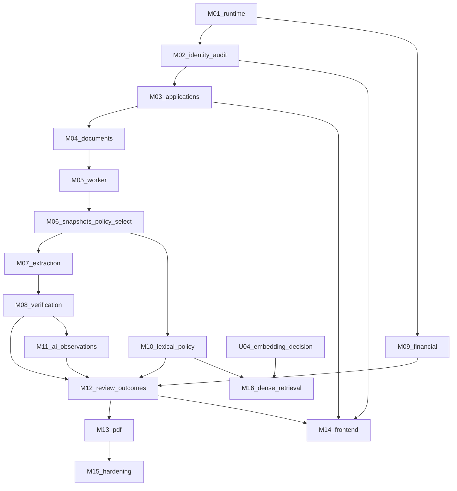

# LoanLens implementation roadmap

| Attribute | Value |
|---|---|
| Product | LoanLens |
| Document | Engineering implementation roadmap |
| Version | 1.0 |
| Date | 04 November 2026 |
| Status | Plan only. No milestone is implemented. |
| Product source | `LoanLens_Final_PRD_v1.0.docx` |
| Architecture | [TECHNICAL_ARCHITECTURE.md](architecture/TECHNICAL_ARCHITECTURE.md) v1.3, especially §15 |
| Database | [DATABASE_DESIGN.md](architecture/DATABASE_DESIGN.md) v1.3 |
| Tools | [TOOLS.md](TOOLS.md) |
| Rules | [AGENT_RULES.md](AGENT_RULES.md) |

This is the build order for the MVP. It does not restate formulas, column lists, or the state diagram. Implementers follow the architecture and database design for those, and stop when [AGENT_RULES.md](AGENT_RULES.md) §2 names a conflict.

No application code, migration, or test run exists in the repository at the time of this version. Every task is Not Started or Blocked. None is Completed.

---

## 1. Project implementation strategy

The MVP is one modular monolith with a separate worker, as in ADR-001 and ADR-006. Build the smallest vertical slice that can be checked, then add the next slice that depends on it.

Sequencing follows Technical Architecture §15. Runtime and the migration tool come first because that section assumes them. Identity comes before lending data. Document bytes come before extraction. The worker shell comes before pipeline nodes. Snapshots and policy selection come before an assessment row. Deterministic rules and calculators come before model prose. Dense retrieval comes last and only after U-04.

Work that does not share a database dependency may proceed in parallel after its prerequisite milestone: pure financial functions after M01, lexical policy ingest after the policy tables exist, and the SPA after the API slices it calls. Do not start a later milestone’s schema “while you are in the file”.

Each milestone produces the companion specification from Architecture §17 and PRD Appendix B that it needs, alongside the code, not as a claim that the specification already exists. Unpublished OpenAPI field schemas are not invented in this roadmap.

Tests follow [AGENT_RULES.md](AGENT_RULES.md) §10. M01 is checked with Compose and Alembic because no test runner is approved. From M02 onward, a runner must have been approved first. The release bar remains PRD §18.2: Must requirements FR-01 through FR-15 on synthetic data, with the checks that section names. This roadmap does not declare that bar met.

Demo data stays synthetic. No milestone adds a credit bureau, an identity authority, or an automatic lending decision.

---

## 2. Milestone structure

The arrow from M09 to M12 means M09-T01, the pure calculators. M09-T02, the persisted rows and triggers, follows M12-T01 and does not need to finish before assembly starts.
| ID | Name | Depends on | Can proceed without |
|---|---|---|---|
| M01 | Repository and runtime foundation | Nothing in the repo | Lending behaviour, ORM, test runner |
| M02 | Identity, sessions, RBAC, audit chain | M01, plus human approval of data access and a test runner, plus the `citext` decision | Documents, worker, LLM |
| M03 | Application intake and ten-state shell | M02 | OCR, assessments |
| M04 | Document intake, scan, hash, download | M03 | Extraction providers |
| M05 | Fenced worker and checkpoints | M04 | Pipeline node logic |
| M06 | Snapshots and policy selection | M05 | Embeddings, full extraction |
| M07 | Classification and extraction | M06 | Review UI |
| M08 | Deterministic verification | M06 for fixtures; persistence with M12 | LLM |
| M09 | Financial calculations | M01 for pure functions; M06 and M12 to persist | LLM |
| M10 | Lexical policy retrieval | M06 | U-04, dense retrieval |
| M11 | Labelled AI observations | M08 for the findings boundary; inserts in M12 | Embedding model |
| M12 | Assessment, review, outcomes | M08, M09, M10, M11 behaviour | PDF library, SPA framework |
| M13 | PDF export | M12 and an approved PDF library | Frontend |
| M14 | Frontend SPA | M02, M03, M12, and an approved framework | Dense retrieval |
| M15 | Observability, evaluation, hardening | M13 for the full synthetic journey; earlier gates apply per milestone | A claim of production certification |
| M16 | Dense retrieval | M10 and a recorded U-04 decision | The lexical path |

---

## 3. Milestone specifications and 4. Task breakdown

Package paths below are the layout in Architecture §4. Exact filenames are to be determined when that package is created. Task status is Not Started unless the row says Blocked. No task is In Progress or Completed.

### M01 — Repository and runtime foundation

| Field | Content |
|---|---|
| Objective | A runnable API and worker skeleton, PostgreSQL 16 with the required extensions, and Alembic, without lending behaviour. |
| Business value | Later milestones share one reproducible runtime. |
| Technical scope | Package layout, environment settings, Compose, the first migration, health checks, JSON logs. |
| Architecture | §3, §4, §14. ADR-001, ADR-006. |
| Database entities | None. Extensions only: `pgcrypto`, `vector`, `btree_gist`. |
| API or UI | `GET` liveness and readiness as far as they can go without a Python database driver. No `web` service. |
| Dependencies | [TOOLS.md](TOOLS.md) approved packages only. |
| Risks | An agent treats the Alembic tutorial as permission to add SQLAlchemy models. |
| Deliverables | Importable packages, Compose file, Alembic environment with empty `target_metadata`, one handwritten revision, log configuration. |
| Acceptance criteria | Compose starts `api`, `worker`, `db`, and `scanner`. `pg_isready` succeeds in `db`. The extension migration applies on an empty database. Application code does not import `sqlalchemy`. No product table, embedding column, provider SDK, ORM, or test framework is added. |
| Exit criteria | The acceptance criteria are observed in a run, and the result is recorded. M02 stays Blocked until its human approvals exist. |

| Task ID | Task | Objective | Scope | Dependencies | Files/components | Tests | Acceptance criteria | Status |
|---|---|---|---|---|---|---|---|---|
| M01-T01 | Package layout | Create the Architecture §4 tree | Importable packages only. No business rules. | None | `apps/api`, `apps/worker`, `modules/*`, `providers/`, `shared/` as named in Architecture §4. Filenames to be determined. | Import the packages. | Each package imports. No lending function is present. | Not Started |
| M01-T02 | Settings | Load environment-driven configuration | Keys the architecture already names: providers, retry limits, max upload size, worker lease TTL. Example env file with empty secrets. | M01-T01 | `shared/` settings. Path to be determined. | Start the process with the example file. | Missing secret files are not required to import settings. No secret value is committed. | Not Started |
| M01-T03 | Compose topology | Run the MVP processes | Services `api`, `worker`, `db` (PostgreSQL 16 with pgvector), `scanner` (ClamAV). Volumes for quarantine, clean files, and database data. | M01-T01 | Compose file at repository root. Path to be determined. | `docker compose` config and a start. | The four services are defined. There is no `web`, Redis, or broker service. | Not Started |
| M01-T04 | Alembic baseline | Establish the only schema path | Handwritten SQL revision enabling `pgcrypto`, `vector`, and `btree_gist`. | M01-T03 | Alembic environment. Path to be determined. | Apply the revision to an empty database. | `target_metadata` is empty. `citext` is not enabled. No product table and no `policy_chunks.embedding`. Application modules do not import `sqlalchemy`. | Not Started |
| M01-T05 | Health | Expose liveness and a worker heartbeat | API liveness. Worker heartbeat. Database health via `pg_isready` in the `db` container. | M01-T03 | `apps/api`, `apps/worker`. Paths to be determined. | Call liveness. Run `pg_isready`. | No Python database driver is added. The API does not open a SQL connection. | Not Started |
| M01-T06 | JSON logs | Emit structured logs | Standard-library logging. Include `request_id` when a request exists. | M01-T01 | `shared/` logging. Path to be determined. | Emit a log line and inspect it. | The line is JSON. A test input containing a secret or raw bytes is not copied into the line. | Not Started |

### M02 — Identity, sessions, RBAC, and the audit chain

| Field | Content |
|---|---|
| Objective | Authenticated callers, three roles, revocable sessions, and one global audit chain. |
| Business value | No later route is anonymous. Admin actions can be audited. |
| Technical scope | `users`, `user_sessions`, `audit_chain_state`, `audit_events`, `append_audit_event`, login, logout, CSRF, Admin user management. |
| Architecture | §4 Identity and Governance, §11 Auth, §12. ADR-012, ADR-019. |
| Database entities | The identity and audit tables in Database Design §4.1 and §4.8. |
| API or UI | Auth login and `me`. Admin user/role management. OpenAPI for these routes, written with the code. |
| Dependencies | M01. Human approval of the data-access approach and the test runner. A human decision on the `citext` mismatch before `users` is created. |
| Risks | Choosing SQLAlchemy because Alembic installed it. Inventing Argon2id costs or session timeouts. |
| Deliverables | Migrations, session cookie behaviour, role checks, chain verifier sketch, API tests for the auth matrix. |
| Acceptance criteria | Unauthenticated calls to protected routes fail. A deactivated user cannot keep a session. Two concurrent audit writers do not fork `chain_seq`. The MVP API does not accept a bearer JWT. |
| Exit criteria | Named tests ran. Passwords are Argon2id hashes. Raw session secrets are not stored. |

| Task ID | Task | Objective | Scope | Dependencies | Files/components | Tests | Acceptance criteria | Status |
|---|---|---|---|---|---|---|---|---|
| M02-T01 | Approve data access | Choose how application code talks to PostgreSQL | A recorded decision. No code. | M01 exit | [TOOLS.md](TOOLS.md) update only if the human asks for that edit in the same decision | None | The decision names one approach. SQLAlchemy remains unapproved unless the decision explicitly approves it. | Blocked |
| M02-T02 | Approve the test runner | Choose the runner for later tasks | A recorded decision. No code until the decision exists. | M01 exit | None until approved | None | The runner is named and version-constrained. | Blocked |
| M02-T03 | Resolve `citext` | Decide `users.email` storage | A recorded decision. Do not change Database Design inside this task unless the human asks. | M02-T01 | None | None | Either `citext` is approved for this column or a person directs a different type. This roadmap does not choose. | Blocked |
| M02-T04 | Identity and audit schema | Add the identity and audit tables | Handwritten Alembic revision for `users`, `user_sessions`, `audit_chain_state`, `audit_events`, and `append_audit_event`, matching Database Design §4.1 and §4.8. | M02-T01, M02-T02, M02-T03 | Alembic revisions. SQL to be determined. | Migration applies. Direct insert into `audit_events` fails. Verifier accepts the genesis row. | Grants match ADR-012. Seed of the singleton chain row uses the genesis hash from the database design. | Blocked |
| M02-T05 | Sessions | Implement login and logout | Argon2id via an approved package. Cookie flags from ADR-019. Store SHA-256 of the secret. Rotate the id on login. Revoke on logout and on `is_active = false`. | M02-T04 | `modules/identity`, `apps/api`. Paths to be determined. | API tests: login, logout, inactive user, missing CSRF on a mutation. | The API rejects a bearer JWT. Cost parameters and timeouts are configuration keys with no invented product default presented as a security requirement. | Blocked |
| M02-T06 | RBAC and Admin users | Enforce the three roles | Admin management of users and roles. Every protected route checks the session. | M02-T05 | `modules/identity`. Paths to be determined. | Role matrix for the routes this milestone owns. | There is no fourth role. | Blocked |

### M03 — Application intake and the ten-state shell

| Field | Content |
|---|---|
| Objective | Loan Officers can create and edit a draft, and the database accepts only the ten PRD states and the edges in Architecture §5. |
| Business value | An application exists before documents and processing. |
| Technical scope | `applications`, `applicants`, `application_state_history`. Draft CRUD. Withdraw and Admin archive where those edges do not enqueue a run. `submitted_at` set once. |
| Architecture | §5. ADR-004, ADR-017. |
| Database entities | Application and applicant tables. Enum `application_status` without `needs_documents`. |
| API or UI | Applications: create, get, update, withdraw. Submit is not completed here. |
| Dependencies | M02. |
| Risks | Adding an eleventh state from the historical changelog. Implementing the full submit transaction before snapshots exist. |
| Deliverables | Migration, edge trigger, draft API, OpenAPI for these routes. |
| Acceptance criteria | A status change without a matching history row fails. `submitted_at` cannot be updated. Money columns use `NUMERIC`, not float. |
| Exit criteria | Database tests for illegal edges and for the ten-value enum ran. |

| Task ID | Task | Objective | Scope | Dependencies | Files/components | Tests | Acceptance criteria | Status |
|---|---|---|---|---|---|---|---|---|
| M03-T01 | Application schema | Store drafts and history | Tables and the status-edge trigger from Architecture §5 and Database Design §4.2. | M02 exit | Alembic revision. | Reject an edge that §5 does not list. Reject a change with no history row. | Enum has the ten PRD states only. | Not Started |
| M03-T02 | Draft API | Create, read, and update drafts | Loan Officer and Admin. Required declared fields stay required. Optional amounts stay null. | M03-T01 | `modules/intake`, `apps/api`. | API tests for role, validation, and null optional amounts. | No amount is coerced to zero. | Not Started |
| M03-T03 | Withdraw and archive | Record the people-owned terminal edges that do not start a run | Withdraw from `draft`. Archive rules that do not need a processing run. | M03-T02 | `modules/intake`, `modules/workflow`. | Role and state tests. | A reason is required where the architecture requires one. | Not Started |

Submit, retry, clarification resume, correction reprocess, and reopen are not M03 tasks. They belong to M06 and M12 because they freeze a snapshot and enqueue a run.

### M04 — Document intake, scan, hash, and download

| Field | Content |
|---|---|
| Objective | Accept only checked, clean, de-duplicated bytes, and stream them back through an authorized route. |
| Business value | Original evidence is retained and is not served from a public URL. |
| Technical scope | Quarantine, ClamAV, `stored_files`, `application_documents`, hash-equality trigger, partial unique hash, mediated download. Upload states: `draft`, `clarification_required`, `processing_failed`. |
| Architecture | §7, §11 Upload, §12. ADR-021, ADR-025. |
| Database entities | `stored_files`, `application_documents`. Failure-event tables may be created here so later nodes have a target; OCR events are written in M07. |
| API or UI | Upload, list, metadata, download content. |
| Dependencies | M03. A magic-byte library if one is approved under [TOOLS.md](TOOLS.md). Signature checking is required; the library is Conditional. |
| Risks | Storing infected bytes. Returning a storage URI. Enabling a second active copy of the same hash. |
| Deliverables | Upload service, scanner integration, download audit event. |
| Acceptance criteria | Infected and scanner-error bytes insert neither row. A hash mismatch cannot insert. A duplicate active hash returns the warning and does not insert a second active row. Reviewers cannot upload. |
| Exit criteria | Tests cover clean, infected, mismatch, duplicate, wrong role, and wrong application state. |

| Task ID | Task | Objective | Scope | Dependencies | Files/components | Tests | Acceptance criteria | Status |
|---|---|---|---|---|---|---|---|---|
| M04-T01 | File schema | Store bytes and document rows | `stored_files` and `application_documents`, hash trigger, partial unique index. ADR-021. | M03 exit | Alembic revision. | Mismatch insert fails. Duplicate active hash fails. | `stored_files` is insert-only. | Not Started |
| M04-T02 | Approve signature checks | Select the magic-byte mechanism | Recorded approval before the upload task adds a library. | M04-T01 | [TOOLS.md](TOOLS.md) only if the human updates it | None | Extension and MIME are not the only checks. | Blocked |
| M04-T03 | Scan and store | Quarantine, scan, then insert | ClamAV `clamd`. Clean result only. | M04-T01, M04-T02 | `modules/intake`, scanner client. Path to be determined. | Clean, infected, and scanner-error fixtures. | Unclean bytes have no document row. The upload error and the audit event are the record. | Blocked |
| M04-T04 | Download | Stream bytes to an authorized caller | `GET` content route. Audit the download. | M04-T03 | `apps/api`. | Loan Officer, Reviewer, Admin succeed when active. Others fail. | The response has no storage URI. | Not Started |

### M05 — Fenced worker and checkpoints

| Field | Content |
|---|---|
| Objective | One active run per application, claimed with `SKIP LOCKED`, fenced, and checkpointed. |
| Business value | Long work leaves the request thread and can be retried without a second broker. |
| Technical scope | `processing_runs`, `workflow_checkpoints`, `workflow_node_events`. Claim, lease, fence, idempotency key. A placeholder node that only checkpoints. |
| Architecture | §6. ADR-006, ADR-015. |
| Database entities | The processing tables in Database Design §4.4. |
| API or UI | Enqueue is not fully wired until M06. Admin/debug read of run status can exist once rows exist. |
| Dependencies | M04. |
| Risks | A stale worker committing after lease loss. Adding Redis. |
| Deliverables | Worker loop and fence trigger. |
| Acceptance criteria | Two claims cannot both run. A write with a stale `claim_fence` fails. Lease expiry does not mark the run failed. |
| Exit criteria | Concurrency tests for the single active run and the stale fence ran. |

| Task ID | Task | Objective | Scope | Dependencies | Files/components | Tests | Acceptance criteria | Status |
|---|---|---|---|---|---|---|---|---|
| M05-T01 | Run schema | Store queued work and checkpoints | Tables, partial unique active run, fence trigger, checkpoint freeze after the run ends. | M04 exit | Alembic revision. | Second active run fails. Stale fence insert fails. | No Redis. | Not Started |
| M05-T02 | Claim loop | Workers take jobs | `FOR UPDATE SKIP LOCKED`, increment `fence_token`, lease renewal. | M05-T01 | `apps/worker`, `modules/workflow`. | Two workers, one run. Expired lease is reclaimable. | Reclaim does not set `failed`. | Not Started |
| M05-T03 | Checkpoint placeholder | Persist node progress | One no-op node writes a succeeded checkpoint. | M05-T02 | `modules/workflow`. | Replay skips the succeeded node. | Checkpoint payload is not a lending result. | Not Started |

### M06 — Snapshots and policy selection

| Field | Content |
|---|---|
| Objective | Every run freezes inputs, and processing stops with no assessment when policy selection is not exactly one active version. |
| Business value | Later assessments can be replayed, and the system does not invent a rate. |
| Technical scope | `application_input_snapshots`, `snapshot_calculation_inputs`, policy document and version tables, non-overlapping active ranges, `select_policy`. Submit transaction from Architecture §11. |
| Architecture | §5, §9, §11 Submit. ADR-008, ADR-009, ADR-016. |
| Database entities | Snapshots, calc inputs, `policy_documents`, `policy_versions`, `policy_threshold_configs`. No `policy_chunks.embedding`. |
| API or UI | Submit from `draft`. Retry remains a new run from `processing_failed` once failure exists. |
| Dependencies | M05. |
| Risks | Creating the embedding column. Computing a ratio in this milestone. |
| Deliverables | Submit transaction, policy-selection node, seed of one fictional non-overlapping policy version for tests. |
| Acceptance criteria | Zero matches yield `no_applicable_policy` and no assessment. More than one match yields `ambiguous_applicable_policy` and no assessment. `submitted_at` is the as-of date. |
| Exit criteria | Tests cover zero, one, and many active versions, and they assert the absence of an assessment row. |

| Task ID | Task | Objective | Scope | Dependencies | Files/components | Tests | Acceptance criteria | Status |
|---|---|---|---|---|---|---|---|---|
| M06-T01 | Snapshot and policy schema | Freeze inputs and policy versions | Tables and the exclusion constraint. Calc-input checks from ADR-009. | M05 exit | Alembic revision. | Overlapping active ranges fail. Verified and missing shapes fail when illegal. | Embedding column is absent. | Not Started |
| M06-T02 | Submit and select policy | Enqueue the first run with a snapshot | Architecture §11 submit transaction and the `select_policy` node. | M06-T01 | `modules/intake`, `modules/policy`, `modules/workflow`. | Zero, one, and many policy versions. | No assessment row on failure. Rate is copied from the policy version, not typed as an application field. | Not Started |

### M07 — Classification and extraction

| Field | Content |
|---|---|
| Objective | Supported documents yield pages and extracted fields with provenance. Failures stay visible. |
| Business value | Reviewers can see evidence instead of a single opaque score. |
| Technical scope | Provider interface for classification and extraction. `document_pages`, `extracted_fields`, `normalized_fields`, failure events. No vendor SDK until approved. |
| Architecture | §7. ADR-003, ADR-011, ADR-013. |
| Database entities | Page, extraction, normalization, and failure tables in Database Design §4.3. |
| API or UI | Document status on the existing document read API. |
| Dependencies | M06. An approved OCR/extraction provider before live calls. The interface and failure behaviour can be built with a fake provider in tests. |
| Risks | Overwriting extraction rows. Treating OCR confidence as truth. Silent provider fallback. |
| Deliverables | Pipeline nodes `classify_documents`, `extract_fields`, `normalize_fields`, and the ingestion note from Architecture §17 for the chosen provider once approved. |
| Acceptance criteria | A field without page and evidence text is not presented as verified. Extraction rows are not updated. Unsupported and OCR failures insert `document_failure_events`. |
| Exit criteria | Tests use a fake provider. A second provider is not called on failure. |

| Task ID | Task | Objective | Scope | Dependencies | Files/components | Tests | Acceptance criteria | Status |
|---|---|---|---|---|---|---|---|---|
| M07-T01 | Extraction schema | Store pages and fields | Composite foreign keys and logical keys from Architecture §6. | M06 exit | Alembic revision. | Cross-application page link fails. Replay does not duplicate a logical key. | Same key with a different payload fails the run. | Not Started |
| M07-T02 | Provider interface | Isolate OCR and extraction | Interface plus a fake adapter. Real SDK only after approval. | M07-T01 | `providers/`. | Outage path records failure after bounded retries. | No silent fallback. | Not Started |
| M07-T03 | Classify and extract nodes | Fill pages and fields | Nodes after `select_policy`. Four value layers stay distinct. | M07-T02 | `modules/document_intelligence`. | Unsupported file, OCR failure, and a field with evidence. | Corrections are not implemented here. | Not Started |

### M08 — Deterministic verification

| Field | Content |
|---|---|
| Objective | BR-01…BR-11 and the checklist produce immutable finding drafts from frozen inputs and extractions. |
| Business value | Discrepancies are reproducible and are not model prose. |
| Technical scope | Pure rule functions. Finding payload shape. Persistence of `findings` rows occurs in the M12 transaction because a finding belongs to an assessment. |
| Architecture | §8. ADR-007, ADR-014. |
| Database entities | `findings` table created before M12 inserts it. `detection_source` is `deterministic` or `checklist` only. |
| API or UI | None until M12. |
| Dependencies | M07 for extraction fixtures. Rules that need only declared fields can be tested with snapshot fixtures from M06. |
| Risks | Calling an LLM inside a rule. Hard-coding a policy threshold. |
| Deliverables | Rule module and the verification note from Architecture §17, limited to behaviour already specified. |
| Acceptance criteria | BR-12 is not a finding. Thresholds are read from policy configuration arguments, not literals. Conflicting values are both returned and neither is chosen. |
| Exit criteria | Unit tests cover each rule’s specified hit and miss, including missing mandatory documents. |

| Task ID | Task | Objective | Scope | Dependencies | Files/components | Tests | Acceptance criteria | Status |
|---|---|---|---|---|---|---|---|---|
| M08-T01 | Findings schema | Prepare immutable finding storage | Table, logical key, no mutable disposition columns. | M06 exit | Alembic revision. | Update and delete are rejected. | `dismissed` is not a column on `findings`. | Not Started |
| M08-T02 | Rule functions | Implement BR-01…BR-11 and the checklist | Pure functions. Return drafts. Do not insert. | M08-T01 | `modules/verification`. | Unit tests per rule. | No network and no LLM. | Not Started |

### M09 — Financial calculations

| Field | Content |
|---|---|
| Objective | EMI, FOIR, and loan-to-annual-income are computed only in the cases ADR-009 and ADR-023 allow. |
| Business value | Affordability figures are auditable and are absent when inputs are not usable. |
| Technical scope | Pure functions first. Row persistence and the net-income trigger with the assessment transaction. |
| Architecture | §8. ADR-004, ADR-009, ADR-023. |
| Database entities | `assessment_calculations` when M12’s transaction exists. The trigger can be migrated with that table. |
| API or UI | Results appear on the assessment read API in M12. |
| Dependencies | Pure functions depend on M01. Persistence depends on M06 and M12. |
| Risks | Float arithmetic. Substituting zero for null. An LLM explanation overwriting the number. |
| Deliverables | Calculator module. Calculation spec section that points at Architecture §8 rather than copying a second formula. |
| Acceptance criteria | The three legal row shapes are the only ones the database accepts. FOIR and loan-to-annual-income follow the net-income trigger. |
| Exit criteria | Unit tests cover zero rate, zero denominator, missing, unverified, disputed, and verified inputs. Database tests cover the tuple once the table exists. |

| Task ID | Task | Objective | Scope | Dependencies | Files/components | Tests | Acceptance criteria | Status |
|---|---|---|---|---|---|---|---|---|
| M09-T01 | Pure calculators | Compute indicators in memory | EMI, FOIR, loan-to-annual-income, and the not-computable branches. Decimal arithmetic. | M01-T01 | `modules/financial`. | Unit tests. No database. | No float. No invented inputs. | Not Started |
| M09-T02 | Calculation rows | Persist legal shapes | Table, tuple check, deferred finding link, net-income trigger. Inserts happen inside the M12 transaction. | M09-T01, M06 exit, M12-T01 | Alembic revision, `modules/financial`. | Database tests for illegal tuples and the trigger. | A not-computable row cannot commit without its finding. | Not Started |

### M10 — Lexical policy retrieval

| Field | Content |
|---|---|
| Objective | After a policy version is selected, retrieve lexical chunks, rerank when a provider is configured, and cite them. |
| Business value | Policy statements in the assessment point at a version, section, and chunk. |
| Technical scope | Chunking, `content_tsv`, GIN index, citation rows, rerank interface. No embedding column. |
| Architecture | §9. ADR-002, ADR-020. |
| Database entities | `policy_chunks` without `embedding`. `assessment_policy_citations` inserted in M12. |
| API or UI | Admin policy upload and version list. |
| Dependencies | M06. A rerank provider package only after approval. |
| Risks | Calling full-text search BM25. Creating `vector(N)` to finish FR-10 early. |
| Deliverables | Ingest path, lexical query, retrieval note that states dense retrieval is off. |
| Acceptance criteria | Queries are limited to the selected version. Empty support is an insufficient-evidence result. The word BM25 does not appear as a description of this index. |
| Exit criteria | Retrieval tests on the fictional policy pass for a known chunk and for an unsupported question. |

| Task ID | Task | Objective | Scope | Dependencies | Files/components | Tests | Acceptance criteria | Status |
|---|---|---|---|---|---|---|---|---|
| M10-T01 | Chunk schema | Store chunk text and a lexical vector | `policy_chunks` with `content_tsv`. | M06 exit | Alembic revision. | GIN index is used by a lexical query. | No `embedding` column and no vector index. | Not Started |
| M10-T02 | Ingest and retrieve | Chunk, search, and cite | Admin upload creates a version. Query returns citations or insufficient evidence. | M10-T01 | `modules/policy`. | Known hit and known miss. | Effective date is the selection already done in M06, not the upload date. | Not Started |
| M10-T03 | Rerank interface | Order candidates through a provider port | Interface plus a passthrough fake. Real provider after approval. | M10-T02 | `providers/`. | Fake rerank changes rank and the citation stores that rank. | No second lexical engine. | Not Started |

### M11 — Labelled AI observations

| Field | Content |
|---|---|
| Objective | BR-12 and other model notes are stored as labelled observations and never as findings. |
| Business value | Reviewers can see model comments without mistaking them for rules. |
| Technical scope | Observation payload, prompt version, provider interface. Inserts occur in the M12 transaction. |
| Architecture | §8 AI observations. ADR-003. |
| Database entities | `ai_observations`, created before M12 inserts them. |
| API or UI | Shown on the assessment payload in M12, in a separate section. |
| Dependencies | M08 so the findings boundary is already tested. A chat provider SDK only after approval. |
| Risks | Promoting an observation into a finding. Using the model to decide an outcome. |
| Deliverables | Observation builder and a fake provider. |
| Acceptance criteria | An observation has an explicit label. It has no severity that feeds the outcome gate. |
| Exit criteria | A test shows a BR-12 signal is rejected if inserted into `findings`. |

| Task ID | Task | Objective | Scope | Dependencies | Files/components | Tests | Acceptance criteria | Status |
|---|---|---|---|---|---|---|---|---|
| M11-T01 | Observation schema and builder | Define the labelled record | Table and a pure builder. No insert in the pipeline yet. | M08-T01 | Alembic revision, `modules/assessment`. | Builder output fails a finding-shaped insert. | `model_generated` or a more specific label is required. | Not Started |
| M11-T02 | Chat provider port | Call a model only behind the interface | Fake adapter. Usage event written on the call. | M11-T01 | `providers/`. | Outage does not fall through to a second vendor. | Document text is not sent as the system prompt. | Not Started |

### M12 — Assessment assembly, review, and outcomes

| Field | Content |
|---|---|
| Objective | One transaction writes the assessment package, and a Reviewer can dispose findings and record an outcome from `in_review`. |
| Business value | The human decision is tied to a reproducible version and cannot skip the Critical gate. |
| Technical scope | `assemble_assessment`. Dispositions, comments, corrections, clarifications, assignments, `record_review_outcome`, `supersede_review_outcome`. |
| Architecture | §10, §11. ADR-007, ADR-010, ADR-014, ADR-018, ADR-022, ADR-023. |
| Database entities | `assessments` and the review tables in Database Design §4.5 and §4.7. |
| API or UI | Assessment read and list. Review routes in Architecture §11 except the blocked escalation outcome. |
| Dependencies | M08, M09, M10, M11. |
| Risks | Implementing the `escalated` outcome path while the PRD and the architecture disagree. Two active outcomes. Updating an outcome row on reopen. |
| Deliverables | Assembly node, review services, OpenAPI for these routes. |
| Acceptance criteria | Critical and insufficient-evidence items block an outcome unless the latest disposition is one of the three in ADR-014. `dismissed` does not pass that gate. Reopen inserts a supersession and does not update the outcome. Referral does not open a clarification. |
| Exit criteria | Concurrency test for two outcome writers. Gate tests for Critical, Major, Minor, and Info. The escalated-outcome task is still Blocked. |

| Task ID | Task | Objective | Scope | Dependencies | Files/components | Tests | Acceptance criteria | Status |
|---|---|---|---|---|---|---|---|---|
| M12-T01 | Assessment schema | Store a versioned package | `assessments` and child foreign keys, including calculations, citations, and observations. | M08-T01, M10-T01, M11-T01 | Alembic revision. | Version numbers are unique per application. Policy id matches the snapshot. | Direct insert of outcomes is revoked once M12-T04 lands. | Not Started |
| M12-T02 | Assembly transaction | Write the package from a succeeded graph | One transaction for assessment, findings, calculations, observations, and citations. | M12-T01, M07 exit, M08-T02, M09-T01, M10-T02, M11-T02 | `modules/assessment`, `modules/workflow`. | Failure in the transaction leaves no assessment. | Not-computable calculations link to their findings at commit. | Not Started |
| M12-T03 | Review actions | Corrections, dispositions, comments, clarification, assignment | Append-only rows. Clarification from `in_review` only. | M12-T02 | `modules/assessment`, `apps/api`. | Role tests. Loan Officer cannot dispose or correct. | Comments have no update path. | Not Started |
| M12-T04 | Outcomes from `in_review` | Record and supersede outcomes | `record_review_outcome` and `supersede_review_outcome` under the application lock. | M12-T03 | Database functions and `modules/assessment`. | Gate tests and a concurrent double-record test. | Status becomes `review_completed`. Referral does not insert a clarification. | Not Started |
| M12-T05 | Outcome from `escalated` | Decide whether the assigned Reviewer may record an outcome while escalated | No implementation. | The conflict in [AGENT_RULES.md](AGENT_RULES.md) §2 | None | None | A person resolves the PRD and architecture wording before any code allows or denies this path. | Blocked |
| M12-T06 | Reopen and correction reprocess | Start a new run without erasing history | Supersession plus the enqueue transaction in Architecture §11. Field correction from `in_review` starts a new run. | M12-T04, M06-T02 | `modules/workflow`, `modules/intake`. | Previous outcome row is unchanged. New assessment version on success. | No `review_completed` to `clarification_required` edge. | Not Started |

### M13 — PDF export

| Field | Content |
|---|---|
| Objective | Export the assessment as a PDF that keeps the traceability Architecture §10 requires. |
| Business value | The report is an MVP deliverable (PRD §16). |
| Technical scope | A renderer behind the assessment module. Library choice is a human approval. |
| Architecture | §10 PDF export. |
| Database entities | Reads only. |
| API or UI | Export PDF for a version. |
| Dependencies | M12. Approved PDF library per [TOOLS.md](TOOLS.md). |
| Risks | Dropping unresolved limitations or merging AI observations into findings in the layout. |
| Deliverables | Export route and a fixture PDF checked for the required sections. |
| Acceptance criteria | The PDF includes source references, calculation inputs, formula identity, rule version, policy citations, labelled observations, failure history, and unresolved limitations. |
| Exit criteria | A synthetic assessment exports, and a checklist assertion reads the required headings or markers. |

| Task ID | Task | Objective | Scope | Dependencies | Files/components | Tests | Acceptance criteria | Status |
|---|---|---|---|---|---|---|---|---|
| M13-T01 | Approve the PDF library | Name the renderer | Recorded decision. | M12 exit | [TOOLS.md](TOOLS.md) only if the human updates it | None | The library is version-constrained. | Blocked |
| M13-T02 | Export route | Render one assessment version | Content list from Architecture §10. | M13-T01 | `modules/assessment`. | Fixture export. | Limitations are present. Observations are in a separate section. | Blocked |

### M14 — Frontend SPA

| Field | Content |
|---|---|
| Objective | Loan Officer, Reviewer, and Admin can complete the synthetic journey in a browser against `/api/v1`. |
| Business value | The product is usable without hand-built HTTP calls. |
| Technical scope | A separate SPA. Framework is not selected. Screens follow the API that exists. Authorization stays on the server. |
| Architecture | §3 frontend row. §11 resource groups. |
| Database entities | None. |
| API or UI | Application draft, upload, status, review, outcome, and admin policy screens, aligned to shipped routes. |
| Dependencies | M02, M03, and M12. M04 through M11 appear in the UI as those APIs exist. An approved framework. |
| Risks | Treating React or Next.js as already chosen. Hiding a button and calling that authorization. |
| Deliverables | Compose `web` service and the screens for the shipped API. |
| Acceptance criteria | The UI uses the session cookie and sends the CSRF token on mutations. It does not decide outcomes by itself. |
| Exit criteria | A browser pass of the synthetic journey against the API, recorded with the checks that ran. |

| Task ID | Task | Objective | Scope | Dependencies | Files/components | Tests | Acceptance criteria | Status |
|---|---|---|---|---|---|---|---|---|
| M14-T01 | Approve the SPA framework | Name the frontend tool | Recorded decision. Architecture §3 examples are not a decision. | M02 exit | [TOOLS.md](TOOLS.md); [ADR-026](architecture/ADR.md) | None | One framework is named (Vite + React). | Done |
| M14-T02 | Officer and review screens | Call the shipped API | Draft, upload, status, review, outcome. Loading and error states for each call. | M14-T01, M12 exit | `apps/web/` | Vitest role/intake/reviewer flow tests | Wrong-role actions are still rejected by the API. | Done |

### M15 — Observability, evaluation, and hardening

| Field | Content |
|---|---|
| Objective | The synthetic journey is measurable, the audit chain is verifiable, and the security tests named in the PRD exist. |
| Business value | Release evidence for PRD §18.2 without a compliance claim. |
| Technical scope | Trace wiring once exporter packages are approved, chain verifier, evaluation harness, authz and prompt-injection tests, log-redaction tests. |
| Architecture | §12, §13, §15 item 12. |
| Database entities | `evaluation_runs`, `llm_usage_events` if not already written by providers. |
| API or UI | Health already exists. Admin audit query if not delivered in M02. |
| Dependencies | M13 for a full journey including PDF. Individual security tests land with the feature they protect and are repeated here. |
| Risks | Publishing an accuracy number that was not measured. Adding a SIEM or APM product without approval. |
| Deliverables | Verifier command, synthetic evaluation run record, security test list with actual results. |
| Acceptance criteria | The verifier fails on a planted gap. Evaluation output is stored as measured metrics only. Prompt-injection text in a fixture does not change the rule result. |
| Exit criteria | The checks in PRD §18.1 that have corresponding features are executed and the failures are listed. |

| Task ID | Task | Objective | Scope | Dependencies | Files/components | Tests | Acceptance criteria | Status |
|---|---|---|---|---|---|---|---|---|
| M15-T01 | Chain verifier | Recompute the audit hash chain | Read-only walk described in Database Design §4.8. | M02 exit | `modules/governance`. | Planted gap fails. | No repair function is included. | Not Started |
| M15-T02 | Evaluation harness | Run the versioned synthetic set | Record `evaluation_runs`. No numeric target. | M12 exit | `modules/governance`. | One synthetic run writes metrics that the run produced. | Unmeasured claims are absent. | Not Started |
| M15-T03 | Security regression | Lock the abuse cases the PRD names | Authz, upload, download, log redaction, prompt injection. | M04, M07, M12 | Test package. Path to be determined. | The cases in PRD §18.1 that apply to shipped features. | Failures are reported, not deleted. | Not Started |
| M15-T04 | Trace export approval | Decide how OpenTelemetry spans are exported | Recorded package decision. | M01 exit | [TOOLS.md](TOOLS.md) only if the human updates it | None | The standard stays OpenTelemetry. | Blocked |

### M16 — Dense retrieval

| Field | Content |
|---|---|
| Objective | Add vector retrieval after the embedding model and dimension are chosen. |
| Business value | Completes the hybrid requirement in FR-10. Until then, lexical retrieval plus rerank is the implemented subset, and FR-10 stays partial. |
| Technical scope | A migration that adds `policy_chunks.embedding` at the chosen N, backfill, and a fused query. |
| Architecture | §9. ADR-020. |
| Database entities | The embedding column and, only then, the vector index. |
| API or UI | No new route required. Citations may include dense hits. |
| Dependencies | M10 and a written U-04 decision that names the provider, the model, and N. |
| Risks | Resizing the column later. Selecting a model inside the task to unblock it. |
| Deliverables | One migration that records N, and retrieval tests that include a dense hit. |
| Acceptance criteria | N matches the approved model. A different dimension is not an in-place type change. |
| Exit criteria | This milestone stays Blocked until U-04 is decided. Lexical behaviour from M10 still passes. |

| Task ID | Task | Objective | Scope | Dependencies | Files/components | Tests | Acceptance criteria | Status |
|---|---|---|---|---|---|---|---|---|
| M16-T01 | Record the embedding decision | Name provider, model, and N | Decision only. | A person | Changelog or ADR update only when the human requests that edit | None | N is an integer tied to the named model. | Blocked |
| M16-T02 | Add the vector column | Store embeddings at N | One Alembic revision. Backfill. Fused retrieval. | M16-T01, M10 exit | `modules/policy`. | Dense hit and a dimension guard. | No in-place resize. | Blocked |

---

## 5. Database implementation sequence

Revisions are handwritten SQL. One Alembic chain. No SQLAlchemy models. No autogenerate.

1. M01-T04: `pgcrypto`, `vector`, `btree_gist`. Not `citext`. Not `uuid-ossp`.
2. After M02-T03: enums that those tables need, then `users`, `user_sessions`, `audit_chain_state`, `audit_events`, `append_audit_event`.
3. M03: `application_status` and the other enums those tables need, `applications`, `applicants`, `application_state_history`, edge trigger.
4. M04: `stored_files`, `application_documents`, hash trigger, partial unique hash.
5. M05: `processing_runs`, `workflow_checkpoints`, `workflow_node_events`, fence trigger.
6. M06: `application_input_snapshots`, `snapshot_calculation_inputs`, `policy_documents`, `policy_versions`, `policy_threshold_configs`, `document_requirements`, exclusion constraint.
7. M07: `document_pages`, `extracted_fields`, `normalized_fields`, `document_failure_events`, `document_failure_resolutions`.
8. M08: `findings`.
9. M10: `policy_chunks` with `content_tsv` only.
10. M11: `ai_observations` table.
11. M12: `assessments`, `assessment_calculations`, `assessment_policy_citations`, `finding_dispositions`, `field_corrections`, `field_review_actions`, `review_comments`, `review_assignments`, `clarifications`, `review_outcomes`, `review_outcome_supersessions`, the outcome functions, and the deferred constraints.
12. M09-T02 lands the calculation trigger in the same revision as `assessment_calculations` if that revision is not already applied in M12. Do not create the table twice.
13. M16, only after U-04: `policy_chunks.embedding` and its index.

Do not create `document_requests`. Apply each revision to an empty database and to a database that has the previous revision. Integration tests for constraints start at M02, after the test runner is approved.

`business_rules_versions` is seeded when verification rules have a version identifier to store, in M08 or M12, using the catalogue approach in Database Design §8. Seed users and the fictional policy wait until the tables exist and passwords come from the environment.

---

## 6. API and frontend implementation sequence

Base path `/api/v1`. The transaction contents in Architecture §11 are binding. Field-level request and response schemas are written in the OpenAPI document produced with each task. This roadmap does not invent those fields.

| Order | Group | Responsibility | Validation | Frontend | Depends on |
|---|---|---|---|---|---|
| 1 | Health | Liveness, readiness, worker heartbeat | None | None in M01 | M01 |
| 2 | Auth and users | Login, `me`, Admin user management | Pydantic plus session and CSRF | After M14-T01 | M02 |
| 3 | Applications | Draft CRUD, withdraw, archive | Required versus optional amounts | Officer screens | M03 |
| 4 | Documents | Upload, list, metadata, download | Type, signature, size, state, role | Upload screen | M04 |
| 5 | Processing | Run status | Session | Status screen | M05, M06 |
| 6 | Policies | Admin upload and versions | Role Admin | Admin screen | M06, M10 |
| 7 | Assessments | Get and list versions | Session | Review screen | M12 |
| 8 | Review | Claim, assign, correct, confirm, dispose, comment, clarify, escalate, outcome, reopen | Role and state in the service and in the database | Review screen | M12, except M12-T05 |
| 9 | PDF | Export one version | Session | Download action | M13 |
| 10 | Audit | Admin query | Role | Admin screen | M02, M15 |

Error bodies use `code`, `message`, `details`, and `request_id`. Collections that list rows use `offset` and `limit`. Long operations return a run id. The client polls. The UI shows loading and the structured error. It does not treat a hidden control as permission.

---

## 7. AI implementation sequence

Prerequisites, in order:

1. Provider interfaces exist before any SDK (M07, M10, M11).
2. Document extraction and normalization preserve provenance (M07).
3. Policy text is chunked for lexical search (M10). Chunking for vectors is the same text plus an embedding, and it waits.
4. Embedding selection is U-04. It is not a task an agent may finish.
5. Retrieval is lexical, then optional rerank (M10). Fusion with dense hits is M16.
6. LLM calls go through the chat port (M11).
7. Structured outputs are validated before insert (M11, M12).
8. Evidence attribution is required for anything shown as a policy statement or a verified field (M07, M10, M12).
9. Guardrails: document text is data; failures are visible; no silent fallback (ADR-003).
10. Evaluation records measured metrics (M15).
11. Observability writes `llm_usage_events` when a call happens. Trace export waits on M15-T04.

Deterministic rules and calculators do not wait on any of these steps.

---

## 8. Testing and quality gates

A milestone is not complete because its code exists. The agent reports Implemented or Tested. A person marks Reviewed and Completed.

| Gate | Applies from | Pass condition |
|---|---|---|
| Code quality | M01 | Layout matches Architecture §4. No unapproved dependency. No secret in the tree. |
| Runtime | M01 | Compose and the extension migration, as M01 specifies. |
| Unit tests | M02, and M09-T01 once the runner exists | The runner approved in M02-T02 executed the new tests. |
| Integration and database integrity | M02 onward | Constraints under test are the real database, not mocks. |
| Security | The milestone that adds the control, repeated in M15 | Unauthenticated and wrong-role calls fail. Uploads and logs meet §12 of the architecture. |
| AI evaluation | M10, M11, M15 | Reported numbers were produced by the run. Dense metrics are absent until M16. |
| End-to-end | M12 for the API journey, M14 for the browser, M13 for PDF | Synthetic data only. Failures stay listed. |

M01 does not fail the unit-test gate for lack of a runner. M02 cannot exit while M02-T01, M02-T02, or M02-T03 is Blocked.

---

## 9. Risk and dependency register

| ID | Kind | Risk | Mitigation |
|---|---|---|---|
| R1 | Deferred decision | U-04 embedding model and dimension | M16 stays Blocked. Lexical path ships without the column. |
| R2 | Conflict | Outcome recording from `escalated` | M12-T05 stays Blocked. Do not implement either interpretation. |
| R3 | Conflict | `CITEXT` versus optional `citext` | M02-T03 stays Blocked. M01 does not enable the extension. |
| R4 | Dependency | Data-access library and database driver are unnamed | M02-T01. Alembic’s SQLAlchemy install is not a decision. |
| R5 | Dependency | Test runner, linters, CI product, PDF library, SPA framework, vulnerability scanner | Each has a Blocked approval task. |
| R6 | Dependency | OCR, chat, and rerank vendors are unnamed | Interfaces and fakes until a person approves an SDK. |
| R7 | Integrity | Stale worker, double outcome, forked audit chain, hash mismatch | ADR-015, ADR-022, ADR-012, ADR-021, with tests in the milestone that adds them. |
| R8 | Financial | Floats, null-as-zero, divide-by-zero, LLM overwrite | M09 pure tests and ADR-023. |
| R9 | AI | Hallucinated policy, prompt injection, observation promoted to finding | Insufficient-evidence path, adversarial fixture in M15, separate tables. |
| R10 | Security | Secrets, unscanned uploads, public file URLs | [TOOLS.md](TOOLS.md) §7 and ADR-025. |
| R11 | Documentation | Historical changelog read as current | [AGENT_RULES.md](AGENT_RULES.md) §1. |
| R12 | Scope | Companion specs in Architecture §17 are not written | Each milestone writes the slice it needs. Do not block M01 on the full set. |
| R13 | Security specification | Retention, Argon2id cost, and session timeouts are unset | Configuration keys only. No invented compliance period. |

---

## 10. Implementation tracking

Update a task’s status only with repository evidence or an explicit human decision.

| Status | Meaning |
|---|---|
| Planned | This document lists the task. The default for Not Started rows. |
| In Progress | A person or agent is changing the repository for that task. |
| Blocked | A named decision or conflict is unresolved. |
| Implemented | The code or migration exists. Checks may still be missing. |
| Tested | The verification named on the task ran, and the result is recorded. |
| Reviewed | A person has reviewed the change. |
| Completed | A person accepts the task. Agents do not set this. |

Current evidence: the repository has the product and architecture documents and these governance files. It has no application package, Compose file, or migration. No task is Implemented, Tested, Reviewed, or Completed.

---

## 11. First implementation milestone

The next work is **M01**. Do not start it as part of writing this roadmap. When a person asks for it, do the tasks in order: M01-T01, M01-T02, M01-T03, M01-T04, M01-T05, M01-T06.

Prerequisites: none in the repository. [TOOLS.md](TOOLS.md) and [AGENT_RULES.md](AGENT_RULES.md) are the constraints.

M01 does not include lending tables, SQLAlchemy models, a Python database driver, a test runner, a frontend, or a provider SDK. After M01 exits, stop. M02 starts only when M02-T01, M02-T02, and M02-T03 are no longer Blocked.

---

*End of IMPLEMENTATION_ROADMAP.md v1.0*
