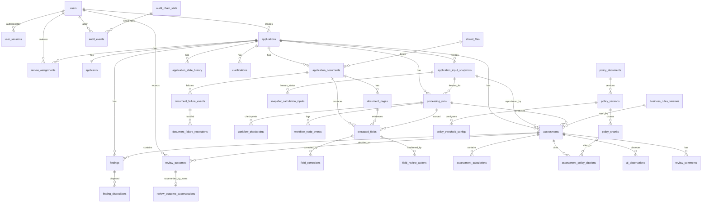

# LoanLens Database Design

| Attribute | Value |
|---|---|
| Product | LoanLens |
| Document | Database Schema & ERD |
| Version | 1.3 |
| Date | 04 November 2026 |
| Status | Baseline for MVP implementation (PRD alignment revision) |
| Source of truth (product) | `LoanLens_Final_PRD_v1.0.docx` |
| Companion | [TECHNICAL_ARCHITECTURE.md](./TECHNICAL_ARCHITECTURE.md) |
| Revision notes | [ARCHITECTURE_REVISION_CHANGELOG.md](./ARCHITECTURE_REVISION_CHANGELOG.md) |
| Consistency | [CONSISTENCY_REPORT.md](./CONSISTENCY_REPORT.md) |
| Engine | PostgreSQL 16 + `pgvector` |

**Version history.** 1.0 (03 Nov 2026) initial schema. 1.1–1.2 (04 Nov 2026) integrity revision. 1.3 (04 Nov 2026) matches PRD v1.0: ten application states, mandatory hash equality, serialized outcome writes, calculation-status tuple, deferred insufficient-evidence link. ADR-005 is withdrawn. Embedding dimension N remains deferred (ADR-020).

**Purpose.** Define the system-of-record schema for MVP: entities, relationships, constraints, indexing, and versioning patterns. API DTOs and storage column micro-optimizations may evolve; **product semantics must not silently diverge from the PRD**.

---

## 1. Design conventions

| Topic | Convention |
|---|---|
| Primary keys | `UUID` (`gen_random_uuid()`) |
| Money | `NUMERIC(18,2)`; currency `CHAR(3)` default `'INR'` |
| Ratios / rates | `NUMERIC(12,6)` (or documented precision); never float |
| Timestamps | `TIMESTAMPTZ` in UTC; `created_at` / `updated_at` where mutable |
| Soft delete | Prefer status/archive flags; **audit, decisions, findings, dispositions, snapshots are append-only** |
| Enums | PostgreSQL `ENUM` or check-constrained text; listed below |
| Content addressing | SHA-256 hex of file bytes for per-application dedup |
| Embedding | `vector(N)` via pgvector. **N is not chosen in this revision** (ADR-020). Do not create the column until the embedding model is selected |
| Multi-tenancy | Single-tenant MVP; no `tenant_id` required now |
| Naming | `snake_case` tables/columns; plural table names |
| Append-only tables | No application `UPDATE`/`DELETE`; DB grants + triggers as defence in depth |

### Value-layer rule (fields)

Never overwrite extraction rows. Human corrections are **new rows** in `field_corrections` referencing the original extraction. Assessments consume values via the input snapshot and the extraction/correction set for that processing run.

### Assessment immutability

Completed assessment versions are immutable. Reopen / reprocess creates a **new** `assessments` row (new version) against a new input snapshot and processing run. Prior outcomes stay as inserted. Reopen adds a row to `review_outcome_supersessions` and does not update the outcome.

### Finding immutability

`findings` are insert-only. Effective status is the latest `finding_dispositions` row, or `open` if none. `dismissed` is a real status and does not satisfy the Critical / insufficient-evidence outcome gate (ADR-014).

---

## 2. Enumerations

```text
user_role                 = loan_officer | reviewer | admin

application_status        = draft | submitted | processing | processing_failed
                          | awaiting_human_review | in_review
                          | clarification_required | escalated
                          | review_completed | archived

applicant_type            = salaried | self_employed

document_type             = identity_proof | pan_card | address_proof
                          | salary_slip | bank_statement | form_16
                          | itr | gst_return | business_proof
                          | existing_loan_statement | unsupported | other

document_status           = uploaded | classified | extracting | extracted
                          | failed | unsupported | replaced

document_failure_event_kind = marked_unsupported | ocr_failed | unreadable
                             | extraction_failed

document_failure_resolution_kind = replacement_requested | replaced
                                 | retry_requested
                                 | accepted_insufficient_evidence

calc_input_status         = missing | unverified | disputed | verified

processing_run_status     = queued | running | succeeded | failed | cancelled

finding_severity          = critical | major | minor | info

finding_disposition_type  = resolved | dismissed | overridden
                          | decision_without_evidence

extraction_review_status  = pending | confirmed | corrected | rejected

calculation_status        = computed | not_computable | provisional

outcome_label             = approved | rejected | referred_for_more_information

policy_status             = draft | active | retired

audit_actor_type          = user | system

detection_source          = deterministic | checklist

field_review_action       = confirmed | rejected
```

A `stored_files` row exists only after a clean malware scan. Infected bytes and scanner errors are not inserted, so there is no scan-status enum to update later (ADR-025).

Notes:

- Business-rule ids (`BR-01` … `BR-12`) remain stable text codes.
- **BR-01…BR-11** (and checklist missing-doc behaviour) produce `findings` with `detection_source ∈ {deterministic, checklist}`.
- **BR-12** and other model signals produce `ai_observations` only—not `findings`.
- Effective finding status is not a mutable column; it is the latest disposition, or `open` if none.
- `dismissed` is allowed (PRD §11 / FR-13). Outcome insert is rejected unless every Critical finding and every finding with `is_insufficient_evidence` has a latest disposition in `{resolved, overridden, decision_without_evidence}` (PRD §7.2).
- `application_status` has the ten PRD §7 values. `needs_documents` is not a value (ADR-017).
- Calculation-input status is frozen on `snapshot_calculation_inputs` and is separate from declared NOT NULL amounts.

---

## 3. Entity-relationship overview



---

## 4. Core tables

### 4.1 Identity

#### `users`

| Column | Type | Notes |
|---|---|---|
| id | UUID PK | |
| email | CITEXT UNIQUE NOT NULL | Login identifier |
| full_name | TEXT NOT NULL | |
| role | user_role NOT NULL | |
| password_hash | TEXT NOT NULL | Argon2id (ADR-019). Parameters come from configuration |
| is_active | BOOLEAN NOT NULL DEFAULT true | |
| created_at | TIMESTAMPTZ NOT NULL | |
| updated_at | TIMESTAMPTZ NOT NULL | |

Indexes: `(role)`, `(is_active)`.

#### `user_sessions`

Server-side sessions (ADR-019). Mutable: last-seen and revocation. The raw cookie secret is never stored.

| Column | Type | Notes |
|---|---|---|
| id | UUID PK | |
| user_id | UUID NOT NULL FK → users | |
| token_hash | CHAR(64) NOT NULL UNIQUE | SHA-256 of the cookie secret |
| created_at | TIMESTAMPTZ NOT NULL | |
| expires_at | TIMESTAMPTZ NOT NULL | Absolute expiry |
| last_seen_at | TIMESTAMPTZ NOT NULL | Idle timeout uses this |
| revoked_at | TIMESTAMPTZ NULL | Set on logout and when the user is deactivated |

Check: `expires_at > created_at`. Index `(user_id)` where `revoked_at IS NULL`.

A request is authenticated only when the hash matches, `revoked_at` is null, `expires_at > now()`, the idle window has not elapsed, and `users.is_active` is true. Deactivation sets `revoked_at` on that user’s open sessions in the same transaction.

---

### 4.2 Applications & applicant data

#### `applications`

| Column | Type | Notes |
|---|---|---|
| id | UUID PK | |
| reference_code | TEXT UNIQUE NOT NULL | Human-friendly id |
| status | application_status NOT NULL | Ten PRD §7 values (ADR-017) |
| created_by_user_id | UUID NOT NULL FK → users | Loan Officer (or Admin acting) |
| assigned_reviewer_user_id | UUID NULL FK → users | Set on claim/assign |
| applicant_type | applicant_type NOT NULL | Drives document matrix |
| requested_amount | NUMERIC(18,2) NOT NULL | > 0 |
| currency | CHAR(3) NOT NULL DEFAULT 'INR' | |
| tenure_months | INTEGER NOT NULL | > 0 |
| loan_purpose | TEXT NOT NULL | Enum-like; `other` requires explanation |
| loan_purpose_other | TEXT NULL | Required when purpose = other |
| applicable_policy_version_id | UUID NULL FK → policy_versions | Resolved at processing; live pointer only |
| withdraw_reason | TEXT NULL | |
| submitted_at | TIMESTAMPTZ NULL | Set once on first transition to `submitted`; never updated (trigger) |
| archived_at | TIMESTAMPTZ NULL | |
| created_at | TIMESTAMPTZ NOT NULL | |
| updated_at | TIMESTAMPTZ NOT NULL | |

Checks:

- `requested_amount > 0`
- `tenure_months > 0`
- `(loan_purpose <> 'other') OR (loan_purpose_other IS NOT NULL AND length(trim(loan_purpose_other)) > 0)`
- `(status <> 'archived') OR (archived_at IS NOT NULL)`

Trigger: if `submitted_at` is already non-null, reject changes to it. State transition to `submitted` sets it when null.

**Status-edge trigger.** `applications.status` may change only along the edges in TECHNICAL_ARCHITECTURE §5, and only in a transaction that inserts `application_state_history` for that same from/to pair. `archived` has no outgoing edge. The trigger checks the edge and the history row. The service checks the actor’s role. Allowed edges:

```text
draft → submitted | archived
submitted → processing
processing → awaiting_human_review | in_review | processing_failed
processing_failed → processing | archived
awaiting_human_review → in_review | archived
in_review → clarification_required | escalated | review_completed | processing
clarification_required → processing | archived
escalated → in_review | review_completed
review_completed → processing | archived
```

**Note:** Annual interest rate is **not** a mutable free-form column on `applications`. It is taken from the single applicable policy version and frozen on the snapshot (ADR-016, PRD §9). Policy as-of date is `(submitted_at AT TIME ZONE 'UTC')::date`.

#### `applicants`

One-to-one with application for MVP (no co-applicants). Live editable declared values; historical values come from snapshots.

| Column | Type | Notes |
|---|---|---|
| id | UUID PK | |
| application_id | UUID UNIQUE NOT NULL FK → applications | |
| full_name | TEXT NOT NULL | Declared |
| date_of_birth | DATE NOT NULL | |
| pan | CHAR(10) NOT NULL | Format-validated in app |
| current_address | TEXT NOT NULL | |
| employer_or_business_name | TEXT NOT NULL | |
| time_in_job_or_business_months | INTEGER NOT NULL | ≥ 0 |
| gross_monthly_income | NUMERIC(18,2) NOT NULL | ≥ 0; declared |
| net_monthly_income | NUMERIC(18,2) NOT NULL | ≥ 0; **declared** only; ≤ gross. Not a verification status |
| other_monthly_income | NUMERIC(18,2) NULL | Optional; if present ≥ 0; unverified by default |
| other_monthly_income_evidenced | BOOLEAN NOT NULL DEFAULT false | |
| monthly_household_expenses | NUMERIC(18,2) NULL | Optional; if present ≥ 0 |
| total_existing_monthly_emis | NUMERIC(18,2) NOT NULL | ≥ 0 |
| outstanding_existing_loan_amount | NUMERIC(18,2) NULL | Optional; if present ≥ 0 |
| created_at | TIMESTAMPTZ NOT NULL | |
| updated_at | TIMESTAMPTZ NOT NULL | |

Checks:

- `time_in_job_or_business_months >= 0`
- `gross_monthly_income >= 0`
- `net_monthly_income >= 0`
- `net_monthly_income <= gross_monthly_income`
- `total_existing_monthly_emis >= 0`
- `other_monthly_income IS NULL OR other_monthly_income >= 0`
- `monthly_household_expenses IS NULL OR monthly_household_expenses >= 0`
- `outstanding_existing_loan_amount IS NULL OR outstanding_existing_loan_amount >= 0`
- `pan ~ '^[A-Z]{5}[0-9]{4}[A-Z]$'` (PRD format check only; no external PAN verification)

Declared values are **never silently overwritten** by extraction. Nullable optional money fields stay NULL when not supplied; do not coerce NULL → 0 for optional fields unless the product form explicitly records zero. Verification for calculations is **not** stored on this live row; it is frozen on `snapshot_calculation_inputs`.

#### `application_input_snapshots`

Versioned freeze of applicant + loan inputs + document inventory identity used by a processing run / assessment. Append-only.

| Column | Type | Notes |
|---|---|---|
| id | UUID PK | |
| application_id | UUID NOT NULL FK → applications | |
| snapshot_number | INTEGER NOT NULL | Monotonic per application |
| applicant_type | applicant_type NOT NULL | |
| requested_amount | NUMERIC(18,2) NOT NULL | |
| currency | CHAR(3) NOT NULL | |
| tenure_months | INTEGER NOT NULL | |
| loan_purpose | TEXT NOT NULL | |
| loan_purpose_other | TEXT NULL | |
| as_of_date | DATE NOT NULL | UTC date of `applications.submitted_at` |
| annual_interest_rate_pct | NUMERIC(12,6) NULL | Copied from the selected policy; NULL only when no policy was selected |
| applicable_policy_version_id | UUID NULL FK → policy_versions | NULL iff selection failed; then the run must fail and no assessment may exist |
| applicant_full_name | TEXT NOT NULL | |
| date_of_birth | DATE NOT NULL | |
| pan | CHAR(10) NOT NULL | |
| current_address | TEXT NOT NULL | |
| employer_or_business_name | TEXT NOT NULL | |
| time_in_job_or_business_months | INTEGER NOT NULL | |
| gross_monthly_income | NUMERIC(18,2) NOT NULL | |
| net_monthly_income | NUMERIC(18,2) NOT NULL | Declared amount copied from `applicants`; status is in `snapshot_calculation_inputs` |
| other_monthly_income | NUMERIC(18,2) NULL | |
| other_monthly_income_evidenced | BOOLEAN NOT NULL | |
| monthly_household_expenses | NUMERIC(18,2) NULL | |
| total_existing_monthly_emis | NUMERIC(18,2) NOT NULL | |
| outstanding_existing_loan_amount | NUMERIC(18,2) NULL | |
| document_inventory_json | JSONB NOT NULL | Active document ids, types, content_sha256, statuses at freeze |
| created_by_run_trigger | TEXT NOT NULL | submit / retry / new_document / correction / documents_ready / reopen_reprocess |
| created_at | TIMESTAMPTZ NOT NULL | |

Unique `(application_id, snapshot_number)`. Also `UNIQUE (id, application_id)` for composite child FKs.

Checks:

- `(applicable_policy_version_id IS NULL) = (annual_interest_rate_pct IS NULL)` — rate comes only from the selected policy (zero rate is stored as 0, not NULL).
- `pan ~ '^[A-Z]{5}[0-9]{4}[A-Z]$'`
- A run that reaches `succeeded` requires `applicable_policy_version_id IS NOT NULL` (trigger on `processing_runs` / `assessments`).
- The same non-negativity checks as `applicants` and `applications` apply to the copied amounts, tenure, and net income ≤ gross.

#### `snapshot_calculation_inputs`

Append-only. One row per input per snapshot. Required names on every snapshot before financial nodes run: `net_monthly_income`, `gross_monthly_income`, `total_existing_monthly_emis`, `requested_amount`, `tenure_months`, `annual_interest_rate_pct`.

| Column | Type | Notes |
|---|---|---|
| id | UUID PK | |
| input_snapshot_id | UUID NOT NULL | Composite FK with `application_id` |
| application_id | UUID NOT NULL | Same application as the snapshot |
| input_name | TEXT NOT NULL | |
| status | calc_input_status NOT NULL | `missing` / `unverified` / `disputed` / `verified` |
| declared_numeric | NUMERIC(18,6) NULL | Copy of declared value when one exists |
| candidate_numeric | NUMERIC(18,6) NULL | Single unconfirmed candidate; only for `unverified` |
| selected_numeric | NUMERIC(18,6) NULL | Only for `verified` |
| evidence_json | JSONB NOT NULL DEFAULT '[]' | Competing values and page ids when `disputed` |
| created_at | TIMESTAMPTZ NOT NULL | |

Unique `(input_snapshot_id, input_name)`.

Checks:

- `status = 'missing'` ⇒ `selected_numeric IS NULL AND candidate_numeric IS NULL`
- `status = 'unverified'` ⇒ `selected_numeric IS NULL AND candidate_numeric IS NOT NULL`
- `status = 'disputed'` ⇒ `selected_numeric IS NULL AND candidate_numeric IS NULL`
- `status = 'verified'` ⇒ `selected_numeric IS NOT NULL AND candidate_numeric IS NULL`
- `input_name = 'net_monthly_income' AND status = 'verified'` ⇒ `selected_numeric >= 0`
- `input_name <> 'net_monthly_income' OR status <> 'missing'` — declared net income is required, so the frozen input is `unverified`, `disputed`, or `verified` (including verified zero). It is never `missing`.
- `input_name = 'annual_interest_rate_pct' AND status = 'missing'` only when the snapshot has no policy version (trigger). A snapshot that has a policy version must freeze that rate as `verified`, including a verified zero.

`disputed` stores both values in `evidence_json` and does not pick one (PRD §9.1).

#### `application_state_history`

| Column | Type | Notes |
|---|---|---|
| id | UUID PK | |
| application_id | UUID NOT NULL FK | |
| from_status | application_status NULL | Null for initial |
| to_status | application_status NOT NULL | |
| actor_type | audit_actor_type NOT NULL | |
| actor_user_id | UUID NULL FK → users | |
| reason | TEXT NULL | |
| created_at | TIMESTAMPTZ NOT NULL | |

Append-only. Index `(application_id, created_at)`.

---

### 4.3 Documents & extraction

#### `stored_files`

Content-addressed byte store. Multiple applications may reference the same hash via separate `application_documents` rows; **dedup uniqueness is per application**, not global.

| Column | Type | Notes |
|---|---|---|
| id | UUID PK | |
| content_sha256 | CHAR(64) NOT NULL UNIQUE | Immutable. One row per distinct byte string |
| storage_uri | TEXT NOT NULL | Internal path or object key. Never returned to clients |
| original_filename | TEXT NOT NULL | |
| mime_type | TEXT NOT NULL | Validated |
| byte_size | BIGINT NOT NULL CHECK (byte_size > 0) | |
| signature_ok | BOOLEAN NOT NULL | Magic-byte check result |
| malware_scanner | TEXT NOT NULL | Scanner name, for example `clamav` |
| malware_scanned_at | TIMESTAMPTZ NOT NULL | Clean scan time. A row is not inserted otherwise |
| malware_signature_version | TEXT NULL | Scanner database version when the product reports one |
| created_at | TIMESTAMPTZ NOT NULL | |

`UNIQUE (content_sha256)`. Check: `char_length(content_sha256) = 64`. Insert-only: revoke `UPDATE` and `DELETE`. Encryption at rest is a volume or server-side storage control, not a column (ADR-025).

Concurrent uploads of the same bytes use `INSERT … ON CONFLICT (content_sha256) DO NOTHING` and then read the existing row. The per-application rule below still blocks a second active document on one application.

#### `application_documents`

| Column | Type | Notes |
|---|---|---|
| id | UUID PK | |
| application_id | UUID NOT NULL FK | |
| stored_file_id | UUID NOT NULL FK → stored_files | |
| content_sha256 | CHAR(64) NOT NULL | Denormalized from `stored_files` for unique constraint |
| document_type | document_type NOT NULL | `unsupported` allowed |
| status | document_status NOT NULL | |
| is_alternative_evidence | BOOLEAN NOT NULL DEFAULT false | Needs Reviewer confirm |
| classification_confidence | NUMERIC(5,4) NULL | |
| classification_method | TEXT NULL | |
| replaced_by_document_id | UUID NULL FK → application_documents | |
| uploaded_by_user_id | UUID NOT NULL FK → users | |
| created_at | TIMESTAMPTZ NOT NULL | |
| updated_at | TIMESTAMPTZ NOT NULL | |

**Dedup & concurrency**

- Partial unique index:  
  `UNIQUE (application_id, content_sha256) WHERE status <> 'replaced' AND replaced_by_document_id IS NULL`  
  Concurrent duplicate uploads fail the unique constraint; API maps to warning / structured duplicate response (PRD: warn, do not store second active copy).
- Check: `char_length(content_sha256) = 64`.
- **Mandatory** `BEFORE INSERT` trigger: `content_sha256` equals `stored_files.content_sha256` for `stored_file_id`. A mismatch raises an exception and rolls back the insert. This trigger is not optional (ADR-021).
- `BEFORE UPDATE` trigger: reject any change to `content_sha256` or `stored_file_id`. Replacement is a new row, not an edit of the hash.
- The referenced `stored_files` row’s scan columns are non-null, which is already required on that table. Processing jobs must not read a document whose insert did not pass this trigger.
- Insert is rejected unless `applications.status` is `draft`, `clarification_required`, or `processing_failed`, and the uploader’s role is `loan_officer` or `admin`. Reviewers cannot insert documents (PRD §11).

Also `UNIQUE (id, application_id)` on `application_documents`.

#### `document_pages`

Run-scoped so OCR replay does not overwrite an earlier run’s text. Composite FKs keep the page on the same application as the document and the run.

| Column | Type | Notes |
|---|---|---|
| id | UUID PK | |
| application_id | UUID NOT NULL | |
| application_document_id | UUID NOT NULL | Composite FK → `application_documents (id, application_id)` |
| processing_run_id | UUID NOT NULL | Composite FK → `processing_runs (id, application_id)` |
| page_number | INTEGER NOT NULL CHECK (page_number >= 1) | 1-based |
| text_content | TEXT NULL | OCR/text layer |
| ocr_status | TEXT NOT NULL | `ok` / `failed` / `skipped` |
| ocr_error | TEXT NULL | |
| claim_fence | BIGINT NOT NULL | Must equal the run’s `fence_token` at insert |
| created_at | TIMESTAMPTZ NOT NULL | |

Unique `(processing_run_id, application_document_id, page_number)`. Unique `(id, application_id)`.

#### `document_failure_events`

Append-only **facts** produced by the pipeline. Not updated when someone later retries or accepts the gap.

| Column | Type | Notes |
|---|---|---|
| id | UUID PK | |
| application_id | UUID NOT NULL | |
| application_document_id | UUID NOT NULL | Composite FK |
| processing_run_id | UUID NOT NULL | Composite FK |
| kind | document_failure_event_kind NOT NULL | |
| affected_pages_json | JSONB NOT NULL DEFAULT '[]' | |
| reason | TEXT NOT NULL | |
| actor_type | audit_actor_type NOT NULL | Usually `system` |
| actor_user_id | UUID NULL FK → users | |
| claim_fence | BIGINT NOT NULL | |
| created_at | TIMESTAMPTZ NOT NULL | |

Unique `(processing_run_id, application_document_id, kind)`. Index `(application_document_id, created_at)`.

#### `document_failure_resolutions`

Append-only **handling** decisions. Each row points at the event it addresses. Inserting a resolution does not change the event.

| Column | Type | Notes |
|---|---|---|
| id | UUID PK | |
| application_id | UUID NOT NULL | |
| document_failure_event_id | UUID NOT NULL | Composite FK → events `(id, application_id)` |
| application_document_id | UUID NOT NULL | Same document as the event (trigger) |
| kind | document_failure_resolution_kind NOT NULL | |
| reason | TEXT NOT NULL | |
| actor_type | audit_actor_type NOT NULL | |
| actor_user_id | UUID NULL FK → users | Required when actor is a user |
| replacement_document_id | UUID NULL | Composite FK to `application_documents` when `kind=replaced` |
| created_at | TIMESTAMPTZ NOT NULL | |

Checks:

- `kind <> 'replaced' OR replacement_document_id IS NOT NULL`
- `length(trim(reason)) > 0`

Index `(document_failure_event_id, created_at)`.

`accepted_insufficient_evidence` does not close a Critical or insufficient-evidence finding. That still requires a `finding_dispositions` row of a §7.2 type.

Resolution kinds are file handling. They map to PRD behaviour as follows. The mapping is the same in TECHNICAL_ARCHITECTURE §7.

| PRD behaviour | Rows | Satisfies the outcome gate |
|---|---|---|
| Unsupported file | Event `marked_unsupported`. Optional later resolutions `replacement_requested`, `replaced` | No |
| OCR failure; retry or replacement | Event `ocr_failed`. Resolution `retry_requested` or `replacement_requested` / `replaced` | No |
| Unreadable; retry, replacement, or clarification | Event `unreadable` plus a finding with `is_insufficient_evidence` when an assessment exists. Clarification is a `clarifications` row, not a resolution kind | No |
| Resolved / overridden / decision without evidence | `finding_dispositions` only. `decision_without_evidence` requires `unresolved_evidence_visible`. `accepted_insufficient_evidence` may sit beside that disposition and does not replace it | Yes, the disposition only |
| Dismiss (FR-13) | `finding_dispositions.disposition = dismissed` | No when the finding is Critical or `is_insufficient_evidence` |

#### `extracted_fields`

Immutable extraction facts (append-only per run).

| Column | Type | Notes |
|---|---|---|
| id | UUID PK | |
| application_id | UUID NOT NULL FK | |
| application_document_id | UUID NOT NULL FK | |
| document_page_id | UUID NULL | Composite FK → `document_pages (id, application_id)` when set |
| processing_run_id | UUID NOT NULL | Composite FK → `processing_runs (id, application_id)` |
| logical_key | TEXT NOT NULL | Stable replay key, e.g. `{document_id}:{field_name}:{page}:{occurrence}` |
| claim_fence | BIGINT NOT NULL | |
| field_name | TEXT NOT NULL | Controlled vocabulary |
| value_text | TEXT NULL | |
| value_numeric | NUMERIC(18,6) NULL | When numeric |
| value_date | DATE NULL | When date |
| currency | CHAR(3) NULL | When money |
| confidence | NUMERIC(5,4) NULL | |
| evidence_text | TEXT NULL | Snippet |
| extraction_method | TEXT NOT NULL | ocr_parse / llm / regex / … |
| review_status | extraction_review_status NOT NULL DEFAULT 'pending' | Frozen at insert. Always `pending` on this row. Effective status is derived (see `field_review_actions`) |
| created_at | TIMESTAMPTZ NOT NULL | |

Checks / rules:

- Verified presentation requires `document_page_id IS NOT NULL` and non-empty `evidence_text`.
- Composite FK already forces the page, document, and run to share `application_id`. Trigger: page’s `application_document_id` equals this row’s `application_document_id` and page’s `processing_run_id` equals this row’s `processing_run_id`.

Unique `(processing_run_id, logical_key)`. Indexes: `(application_id, field_name)`, `(document_page_id)`.

Revoke `UPDATE` and `DELETE`. `review_status` is not a mutable workflow column.

#### `field_review_actions`

Append-only Reviewer confirmation that does not change the extracted value (BR-11). A changed value is a `field_corrections` row instead.

| Column | Type | Notes |
|---|---|---|
| id | UUID PK | |
| application_id | UUID NOT NULL | |
| extracted_field_id | UUID NOT NULL | Composite FK → `extracted_fields (id, application_id)` |
| action | field_review_action NOT NULL | `confirmed` or `rejected` |
| reason | TEXT NOT NULL | |
| actor_user_id | UUID NOT NULL FK → users | Must be an active Reviewer (trigger) |
| created_at | TIMESTAMPTZ NOT NULL | |

Check: `length(trim(reason)) > 0`.

Effective review status for display and PDF: `corrected` when any `field_corrections` row exists for the extraction; otherwise the latest `field_review_actions.action`; otherwise `pending`. The extraction row stays `pending`.

#### `normalized_fields`

Optional derived normalization layer (canonical casing, date formats, amount scale).

| Column | Type | Notes |
|---|---|---|
| id | UUID PK | |
| application_id | UUID NOT NULL | Composite FK with the extraction and the run |
| extracted_field_id | UUID NOT NULL | Composite FK → `extracted_fields (id, application_id)` |
| processing_run_id | UUID NOT NULL | Composite FK → `processing_runs (id, application_id)` |
| field_name | TEXT NOT NULL | |
| normalized_value_text | TEXT NULL | |
| normalized_value_numeric | NUMERIC(18,6) NULL | |
| normalized_value_date | DATE NULL | |
| normalization_ruleset_version | TEXT NOT NULL | |
| created_at | TIMESTAMPTZ NOT NULL | |

#### `field_corrections`

Human-corrected values; original extraction retained. Append-only.

| Column | Type | Notes |
|---|---|---|
| id | UUID PK | |
| extracted_field_id | UUID NOT NULL | Composite FK → `extracted_fields (id, application_id)` |
| application_id | UUID NOT NULL | |
| assessment_id | UUID NULL | Composite FK → `assessments (id, application_id)` when set |
| corrected_value_text | TEXT NULL | |
| corrected_value_numeric | NUMERIC(18,6) NULL | |
| corrected_value_date | DATE NULL | |
| reason | TEXT NOT NULL | Required |
| corrected_by_user_id | UUID NOT NULL FK → users | Reviewer |
| created_at | TIMESTAMPTZ NOT NULL | |

---

### 4.4 Processing runs & workflow

#### `processing_runs`

| Column | Type | Notes |
|---|---|---|
| id | UUID PK | |
| application_id | UUID NOT NULL FK | |
| input_snapshot_id | UUID NOT NULL | Composite FK → `application_input_snapshots (id, application_id)` |
| status | processing_run_status NOT NULL | |
| attempt_number | INTEGER NOT NULL CHECK (attempt_number >= 1) | |
| trigger | TEXT NOT NULL | submit / retry / new_document / correction / documents_ready / reopen_reprocess |
| idempotency_key | TEXT NULL | Client/API key |
| fence_token | BIGINT NOT NULL DEFAULT 0 | Incremented on every claim and reclaim |
| locked_by | TEXT NULL | Worker instance id |
| locked_at | TIMESTAMPTZ NULL | Lease start |
| lease_expires_at | TIMESTAMPTZ NULL | |
| started_at | TIMESTAMPTZ NULL | |
| finished_at | TIMESTAMPTZ NULL | |
| error_code | TEXT NULL | |
| error_message | TEXT NULL | |
| provider_snapshot_json | JSONB NOT NULL DEFAULT '{}' | Models/providers used |
| created_at | TIMESTAMPTZ NOT NULL | |

Constraints / indexes:

- Partial unique: **at most one** run with `status IN ('queued','running')` per `application_id`.
- Partial unique: `(application_id, idempotency_key)` WHERE `idempotency_key IS NOT NULL`.
- Index `(status, lease_expires_at)` for claim/reclaim.
- Index `(application_id, created_at DESC)`.
- Check: `(status <> 'succeeded') OR (finished_at IS NOT NULL)`.
- Check: `(status <> 'failed') OR (error_code IS NOT NULL)`.
- Check: `fence_token >= 0`.
- `UNIQUE (id, application_id)`.
- Trigger: `status = 'succeeded'` only if the snapshot’s `applicable_policy_version_id` is not null.
- Trigger: `error_code IN ('no_applicable_policy','ambiguous_applicable_policy')` implies `status = 'failed'` and no `assessments` row for this run.
- Side-effect trigger: `claim_fence` on child inserts must equal current `fence_token`.

Claim / reclaim (same transaction):

```text
SELECT … FROM processing_runs
 WHERE status = 'queued'
    OR (status = 'running' AND lease_expires_at < now())
 ORDER BY created_at
 FOR UPDATE SKIP LOCKED
 LIMIT 1;

UPDATE processing_runs
   SET fence_token = fence_token + 1,
       status = 'running',
       locked_by = :worker,
       locked_at = now(),
       lease_expires_at = now() + :ttl
 WHERE id = :id;
```

Lease extend: `WHERE id=:id AND fence_token=:held AND locked_by=:worker`. Zero rows ⇒ stale worker stops.

#### `workflow_checkpoints`

Resume points for LangGraph nodes. Upsert by `(processing_run_id, node_name)` only while run is active; treat historical succeeded checkpoints as immutable after run completes.

| Column | Type | Notes |
|---|---|---|
| id | UUID PK | |
| application_id | UUID NOT NULL | |
| processing_run_id | UUID NOT NULL | Composite FK → `processing_runs (id, application_id)` |
| claim_fence | BIGINT NOT NULL | Fence held when the checkpoint was written |
| node_name | TEXT NOT NULL | |
| sequence_no | INTEGER NOT NULL | |
| status | TEXT NOT NULL | `succeeded` / `failed` / `skipped` |
| state_json | JSONB NOT NULL | Graph state needed to resume downstream |
| error_code | TEXT NULL | |
| created_at | TIMESTAMPTZ NOT NULL | |
| updated_at | TIMESTAMPTZ NOT NULL | |

Unique `(processing_run_id, node_name)`. Unique `(processing_run_id, sequence_no)`.

Trigger: updates allowed only while the parent run is `running` and `claim_fence` equals `processing_runs.fence_token`. After `succeeded` or `failed`, updates are rejected.

#### `workflow_node_events`

Fine-grained append-only node log for observability (separate from checkpoints).

| Column | Type | Notes |
|---|---|---|
| id | UUID PK | |
| application_id | UUID NOT NULL | |
| processing_run_id | UUID NOT NULL | Composite FK → `processing_runs (id, application_id)` |
| node_name | TEXT NOT NULL | |
| status | TEXT NOT NULL | |
| detail_json | JSONB NOT NULL DEFAULT '{}' | |
| created_at | TIMESTAMPTZ NOT NULL | |

---

### 4.5 Findings, calculations, assessments

#### `business_rules_versions`

| Column | Type | Notes |
|---|---|---|
| id | UUID PK | |
| version_label | TEXT UNIQUE NOT NULL | e.g. `rules-2026.11.01` |
| catalogue_json | JSONB NOT NULL | BR metadata snapshot |
| created_at | TIMESTAMPTZ NOT NULL | |

#### `assessments`

| Column | Type | Notes |
|---|---|---|
| id | UUID PK | |
| application_id | UUID NOT NULL FK | |
| processing_run_id | UUID NOT NULL | Composite FK → `processing_runs (id, application_id)`; UNIQUE so one assessment per run |
| input_snapshot_id | UUID NOT NULL | Composite FK → snapshots `(id, application_id)` |
| version_number | INTEGER NOT NULL | Per application, monotonic |
| policy_version_id | UUID NOT NULL FK → policy_versions | Must equal the snapshot’s `applicable_policy_version_id` (trigger) |
| business_rules_version_id | UUID NOT NULL FK | |
| prompt_version | TEXT NULL | |
| model_provider_snapshot_json | JSONB NOT NULL DEFAULT '{}' | |
| embedding_version | TEXT NULL | |
| reranker_version | TEXT NULL | |
| evaluation_dataset_version | TEXT NULL | When from eval harness |
| summary_json | JSONB NOT NULL DEFAULT '{}' | Structured assessment body |
| unresolved_evidence_summary | TEXT NULL | Must surface in PDF |
| created_at | TIMESTAMPTZ NOT NULL | |

Unique `(application_id, version_number)`. Unique `(id, application_id)`.

Triggers:

- `processing_runs.input_snapshot_id = assessments.input_snapshot_id` (same run, same snapshot).
- `policy_version_id = snapshot.applicable_policy_version_id`.
- Reject insert when that policy id is null (no assessment without a selected policy).

#### `findings`

Immutable deterministic / checklist findings for an assessment version. **No disposition columns.**

| Column | Type | Notes |
|---|---|---|
| id | UUID PK | |
| application_id | UUID NOT NULL FK | |
| assessment_id | UUID NOT NULL | Composite FK → `assessments (id, application_id)` |
| logical_key | TEXT NOT NULL | Stable key, e.g. `{rule_code}:{subject}` |
| claim_fence | BIGINT NOT NULL | |
| rule_code | TEXT NOT NULL | e.g. BR-05; checklist codes allowed |
| finding_type | TEXT NOT NULL | Stable type key |
| severity | finding_severity NOT NULL | |
| title | TEXT NOT NULL | |
| description | TEXT NOT NULL | |
| detection_source | detection_source NOT NULL | `deterministic` \| `checklist` only |
| is_insufficient_evidence | BOOLEAN NOT NULL DEFAULT false | True for §7.2 insufficient-evidence findings, including every not-computable calculation’s finding and unreadable-document gaps. Not true for ordinary Info checklist rows |
| evidence_json | JSONB NOT NULL DEFAULT '[]' | Doc / document_page_id / field refs |
| created_at | TIMESTAMPTZ NOT NULL | |

Unique `(assessment_id, logical_key)`. Unique `(id, application_id)`. Index `(assessment_id, severity)`, `(rule_code)`.

#### `finding_dispositions`

Append-only Reviewer dispositions. Effective status = latest row by `created_at` (or `open` if none).

| Column | Type | Notes |
|---|---|---|
| id | UUID PK | |
| finding_id | UUID NOT NULL | Composite FK → `findings (id, application_id)` |
| application_id | UUID NOT NULL | |
| assessment_id | UUID NOT NULL | Composite FK → `assessments (id, application_id)`; must equal the finding’s assessment (trigger) |
| disposition | finding_disposition_type NOT NULL | Includes `dismissed`; see gate below |
| reason | TEXT NOT NULL | Required for all disposition types |
| supporting_evidence_json | JSONB NOT NULL DEFAULT '[]' | For `resolved` |
| unresolved_evidence_visible | BOOLEAN NOT NULL DEFAULT false | Must be true for `decision_without_evidence` |
| disposed_by_user_id | UUID NOT NULL FK → users | Reviewer |
| created_at | TIMESTAMPTZ NOT NULL | |

Checks:

- `(disposition <> 'decision_without_evidence') OR (unresolved_evidence_visible = true)`
- `length(trim(reason)) > 0`

Index `(finding_id, created_at DESC)`, `(assessment_id)`.

**Outcome gate (inside `record_review_outcome`, ADR-014):** for every finding on that assessment with `severity = critical`, and every finding with `is_insufficient_evidence`, the latest disposition (by `created_at`, then `id`) must be in `resolved`, `overridden`, `decision_without_evidence`. Latest `dismissed` or no row fails the insert. `dismissed` remains a legal disposition for non-gating findings (PRD §11).

**Major gate (PRD §10.1):** every finding with `severity = major` has at least one `review_comments` row for that finding or at least one `finding_dispositions` row. Minor and Info do not block.

#### `assessment_calculations`

| Column | Type | Notes |
|---|---|---|
| id | UUID PK | |
| application_id | UUID NOT NULL | |
| assessment_id | UUID NOT NULL | Composite FK → `assessments (id, application_id)` |
| indicator_name | TEXT NOT NULL | `proposed_emi` / `foir` / `lti` / … |
| status | calculation_status NOT NULL | |
| result_numeric | NUMERIC(18,6) NULL | |
| inputs_json | JSONB NOT NULL | Must list each input, source (snapshot/extraction/correction), and sufficiency flag |
| formula_text | TEXT NOT NULL | |
| is_provisional | BOOLEAN NOT NULL DEFAULT false | |
| limitation_text | TEXT NULL | |
| insufficient_evidence_finding_id | UUID NULL | Composite FK → `findings (id, application_id)`, **DEFERRABLE INITIALLY DEFERRED** |
| created_at | TIMESTAMPTZ NOT NULL | |

Unique `(assessment_id, indicator_name)`.

**Mandatory tuple check** (ADR-023). Exactly one branch must match:

```text
(status = 'computed'
  AND result_numeric IS NOT NULL
  AND is_provisional = false
  AND limitation_text IS NULL
  AND insufficient_evidence_finding_id IS NULL)
OR
(status = 'not_computable'
  AND result_numeric IS NULL
  AND is_provisional = false
  AND (limitation_text IS NULL OR length(trim(limitation_text)) > 0)
  AND insufficient_evidence_finding_id IS NOT NULL)
OR
(status = 'provisional'
  AND result_numeric IS NOT NULL
  AND is_provisional = true
  AND limitation_text IS NOT NULL
  AND length(trim(limitation_text)) > 0
  AND insufficient_evidence_finding_id IS NULL)
```

The foreign key is deferred so, inside the assessment transaction, the finding row may be inserted before or after the calculation row. The calculation insert must already carry the finding UUID when status is `not_computable` (the CHECK is immediate). At COMMIT the finding row must exist.

Deferred constraint trigger: when `insufficient_evidence_finding_id` is not null, that finding has `is_insufficient_evidence = true`, the same `assessment_id`, and the same `application_id`. U-06 is closed. There is no service-only exception.

**Net-income trigger** (`BEFORE INSERT` on `assessment_calculations`, for `indicator_name IN ('foir','lti')`), reading `snapshot_calculation_inputs` for `net_monthly_income` via the assessment’s snapshot:

| Frozen status of `net_monthly_income` | Allowed calculation status |
|---|---|
| `missing` | Rejected by the snapshot check. This input cannot be `missing` |
| `disputed`, or `verified` with `selected_numeric = 0` | `not_computable` only, `result_numeric` NULL, `is_provisional` false |
| `unverified` and `candidate_numeric > 0` | `not_computable`, or `provisional` with limitation text |
| `unverified` and (`candidate_numeric` NULL or `<= 0`) | `not_computable` only |
| `verified` and `selected_numeric > 0` | `computed` if other required inputs are also `verified`; otherwise `not_computable` |

`computed` must use `selected_numeric`, never `candidate_numeric`, and must have `is_provisional = false` and `limitation_text` NULL. `provisional` must copy `candidate_numeric` into `inputs_json`, set `is_provisional`, and set `limitation_text`. The same predicate applies to any other ratio whose formula divides by net monthly income. On an assessment, `annual_interest_rate_pct` is `verified` (ADR-016). Zero rate uses the PRD zero-interest branch and is `computed`. A missing rate, principal, or tenure makes `proposed_emi` `not_computable` if a calculation row is inserted at all.

#### `ai_observations`

Labelled model-generated notes, **including BR-12 anomaly signals**. Never mixed into `findings`.

| Column | Type | Notes |
|---|---|---|
| id | UUID PK | |
| application_id | UUID NOT NULL | |
| assessment_id | UUID NOT NULL | Composite FK → `assessments (id, application_id)` |
| logical_key | TEXT NOT NULL | Replay key, e.g. `BR-12:{subject}` |
| claim_fence | BIGINT NOT NULL | |
| observation_text | TEXT NOT NULL | |
| label | TEXT NOT NULL DEFAULT 'model_generated' | e.g. `model_generated`, `anomaly_signal_br12` |
| rule_code | TEXT NULL | `BR-12` when applicable |
| evidence_json | JSONB NOT NULL DEFAULT '[]' | |
| created_at | TIMESTAMPTZ NOT NULL | |

Unique `(assessment_id, logical_key)`. Index `(rule_code)`.

---

### 4.6 Policy store & retrieval

#### `policy_documents`

| Column | Type | Notes |
|---|---|---|
| id | UUID PK | |
| title | TEXT NOT NULL | |
| lender_label | TEXT NOT NULL DEFAULT 'synthetic_demo' | Fictional MVP set |
| created_by_user_id | UUID NOT NULL FK | |
| created_at | TIMESTAMPTZ NOT NULL | |

#### `policy_versions`

| Column | Type | Notes |
|---|---|---|
| id | UUID PK | |
| policy_document_id | UUID NOT NULL FK | |
| version_label | TEXT NOT NULL | |
| status | policy_status NOT NULL | |
| effective_from | DATE NOT NULL | Selection key |
| effective_to | DATE NULL | |
| source_stored_file_id | UUID NULL FK → stored_files | |
| checksum_sha256 | CHAR(64) NULL | |
| annual_interest_rate_pct | NUMERIC(12,6) NOT NULL | Product rate for this policy version (PRD §9) |
| created_at | TIMESTAMPTZ NOT NULL | |

Unique `(policy_document_id, version_label)`.

Check: `effective_to IS NULL OR effective_to >= effective_from`.  
Check: `annual_interest_rate_pct >= 0`.

Exclusion (requires `btree_gist`): active versions must not have overlapping inclusive date ranges, across policy documents:

```text
EXCLUDE USING gist (
  daterange(effective_from, COALESCE(effective_to, 'infinity'), '[]') WITH &&
) WHERE (status = 'active')
```

The workflow still counts matches for the as-of date and fails the run if the count is not 1 (ADR-016). The constraint stops the overlap being saved; the count check covers races and any row the constraint does not see.

#### `policy_threshold_configs`

Versioned numeric/text thresholds used by BR-* (name tolerance, FOIR max, statement recency, confidence floor, retry limit pointers, etc.).

| Column | Type | Notes |
|---|---|---|
| id | UUID PK | |
| policy_version_id | UUID NOT NULL FK | |
| key | TEXT NOT NULL | |
| value_json | JSONB NOT NULL | |
| created_at | TIMESTAMPTZ NOT NULL | |

Unique `(policy_version_id, key)`.

#### `policy_chunks`

| Column | Type | Notes |
|---|---|---|
| id | UUID PK | |
| policy_version_id | UUID NOT NULL FK | |
| chunk_index | INTEGER NOT NULL | |
| section_label | TEXT NULL | |
| page_from | INTEGER NULL | |
| page_to | INTEGER NULL | |
| content_text | TEXT NOT NULL | |
| content_tsv | TSVECTOR | Generated/maintained for FTS |
| embedding | vector(N) NULL | **Column omitted until N is chosen** (ADR-020). After it exists, N is fixed for that column |
| embedding_model | TEXT NULL | Required on rows that have an embedding. Null while dense retrieval is off |
| created_at | TIMESTAMPTZ NOT NULL | |

Indexes:

- GIN on `content_tsv` for PostgreSQL full-text search. This index is lexical search. It is not a BM25 index and must not be described as one.
- ivfflat or hnsw on `embedding` only after N is known (ADR-020). Until then, retrieval is lexical plus rerank of those lexical candidates.
- `(policy_version_id, chunk_index)` unique

#### `assessment_policy_citations`

| Column | Type | Notes |
|---|---|---|
| id | UUID PK | |
| assessment_id | UUID NOT NULL FK | |
| policy_chunk_id | UUID NOT NULL FK | |
| query_text | TEXT NOT NULL | |
| rank | INTEGER NOT NULL | Post-rerank |
| score | NUMERIC(12,6) NULL | |
| cited_excerpt | TEXT NOT NULL | |
| created_at | TIMESTAMPTZ NOT NULL | |

---

### 4.7 Human review

#### `review_assignments`

| Column | Type | Notes |
|---|---|---|
| id | UUID PK | |
| application_id | UUID NOT NULL FK | |
| reviewer_user_id | UUID NOT NULL FK | |
| assigned_by_user_id | UUID NULL FK | Null if self-claim |
| assignment_method | TEXT NOT NULL | self_claim / admin_assign |
| active | BOOLEAN NOT NULL DEFAULT true | |
| created_at | TIMESTAMPTZ NOT NULL | |
| released_at | TIMESTAMPTZ NULL | |

Partial unique: one active assignment per application —  
`UNIQUE (application_id) WHERE active = true`.

#### `clarifications`

| Column | Type | Notes |
|---|---|---|
| id | UUID PK | |
| application_id | UUID NOT NULL FK | |
| assessment_id | UUID NULL FK | |
| question_text | TEXT NOT NULL | |
| asked_by_user_id | UUID NOT NULL FK | Reviewer |
| response_text | TEXT NULL | Loan Officer |
| responded_by_user_id | UUID NULL FK | |
| status | TEXT NOT NULL | open / answered / cancelled |
| created_at | TIMESTAMPTZ NOT NULL | |
| responded_at | TIMESTAMPTZ NULL | |

Checks:

- `length(trim(question_text)) > 0`
- `status <> 'answered' OR (responded_at IS NOT NULL AND responded_by_user_id IS NOT NULL)`
- Trigger when status becomes `answered`: `response_text` is non-empty, or at least one non-replaced `application_documents` row for this application has `created_at >= clarifications.created_at`. Text and a new document may both be present. One of them is required.
- Trigger: `asked_by_user_id` is an active Reviewer. `question_text` cannot be updated after insert.

This table is the MVP record for “request clarification” and for asking for additional documents (ADR-018). The question names any documents. There is no `document_requests` table (ADR-024).

**Limitation.** The MVP cannot store an open/fulfilled status per document type. Fulfillment is “the Loan Officer submitted a response and/or uploaded documents after `created_at`.”

Resume is allowed when status is `open` and either `response_text` will be non-empty or at least one non-replaced `application_documents` row for the application has `created_at >= clarifications.created_at`. The submit-response transaction sets `answered`, `responded_at`, and `responded_by_user_id`, then enqueues the run. Upload by itself does not change `applications.status`.

#### `review_comments`

Immutable once saved (PRD: cannot edit/delete).

| Column | Type | Notes |
|---|---|---|
| id | UUID PK | |
| application_id | UUID NOT NULL FK | |
| assessment_id | UUID NOT NULL FK | |
| finding_id | UUID NULL FK | Null = application-level |
| body | TEXT NOT NULL | |
| author_user_id | UUID NOT NULL FK | |
| created_at | TIMESTAMPTZ NOT NULL | |

No `updated_at`. No delete API.

#### `review_outcomes`

Append-only. Historical outcomes remain queryable after reopen.

| Column | Type | Notes |
|---|---|---|
| id | UUID PK | |
| application_id | UUID NOT NULL FK | |
| assessment_id | UUID NOT NULL FK | Outcome tied to assessment version |
| outcome | outcome_label NOT NULL | |
| rationale | TEXT NOT NULL | |
| recorded_by_user_id | UUID NOT NULL FK | Must be Reviewer |
| recorded_at | TIMESTAMPTZ NOT NULL | |
| created_at | TIMESTAMPTZ NOT NULL | |

No `superseded` columns. The row is never updated.

Unique `(assessment_id)`. Unique `(id, application_id)`. Composite FK `(assessment_id, application_id)` → `assessments`.

**Writers (ADR-022).** Revoke `INSERT`, `UPDATE`, and `DELETE` from the application role. The only insert path is `record_review_outcome(...)`.

`record_review_outcome`, in one transaction:

1. `SELECT id FROM applications WHERE id = :application_id FOR UPDATE`.
2. Require `status IN ('in_review','escalated')`.
3. Require the caller to be an active user with `role = reviewer` and the active `review_assignments` row for this application.
4. Apply the Critical / `is_insufficient_evidence` gate and the Major comment-or-disposition gate.
5. Reject when an unsurperseded outcome already exists for this application.
6. Insert the outcome row.
7. The caller then writes `application_state_history` and sets status to `review_completed` in the same transaction.

A check that only `SELECT`s other outcomes, without the `FOR UPDATE`, is not sufficient. Two READ COMMITTED transactions would both pass it.

**Deferred constraint trigger** `review_outcomes_one_active`: at commit, each `application_id` has at most one `review_outcomes` row whose id is absent from `review_outcome_supersessions.outcome_id`. This holds even if a writer inserted twice in one transaction.

#### `review_outcome_supersessions`

Append-only reopen record. Does not modify `review_outcomes`.

| Column | Type | Notes |
|---|---|---|
| id | UUID PK | |
| application_id | UUID NOT NULL | |
| outcome_id | UUID NOT NULL | Composite FK → `review_outcomes (id, application_id)` |
| reason | TEXT NOT NULL | PRD reopen reason |
| actor_user_id | UUID NOT NULL FK → users | Reviewer |
| created_at | TIMESTAMPTZ NOT NULL | |

Unique `(outcome_id)` — an outcome is superseded at most once.

Check: `length(trim(reason)) > 0`.

Direct `INSERT` is revoked. `supersede_review_outcome(...)` locks the same `applications` row `FOR UPDATE`, requires status `review_completed`, requires an active Reviewer, requires a non-empty reason, and inserts one supersession row. The reopen service then inserts the next snapshot and queued run in that same transaction. The outcome row is not updated.

Current outcome for an application = the `review_outcomes` row whose id is not in this table. After the supersession commits, a later assessment may receive a new outcome row. Two concurrent `record_review_outcome` calls, or a concurrent record and supersede, serialize on the application row lock. The loser either waits and then fails the active-outcome check, or waits and then supersedes the winner’s row, but cannot leave two active outcomes.

---

### 4.8 Governance & observability aids

#### `audit_chain_state`

Singleton lock row. Seed exactly one row: `chain_seq = 0`, `last_event_hash` = 64 zero hex digits (genesis). No second row.

| Column | Type | Notes |
|---|---|---|
| id | SMALLINT PK | `CHECK (id = 1)` |
| last_chain_seq | BIGINT NOT NULL | |
| last_event_hash | CHAR(64) NOT NULL | |

#### `audit_events`

Append-only. One global chain (ADR-012). Application-level and admin events share the sequence so concurrent writers cannot fork.

| Column | Type | Notes |
|---|---|---|
| id | UUID PK | |
| chain_seq | BIGINT NOT NULL UNIQUE | 1, 2, 3, … no gaps |
| application_id | UUID NULL FK | Null for user-admin events |
| actor_type | audit_actor_type NOT NULL | |
| actor_user_id | UUID NULL FK | |
| action | TEXT NOT NULL | e.g. `application.submit`, `finding.dispose`, `document.failure` |
| entity_type | TEXT NULL | |
| entity_id | UUID NULL | |
| rationale | TEXT NULL | |
| before_json | JSONB NULL | |
| after_json | JSONB NULL | |
| assessment_id | UUID NULL | |
| request_id | TEXT NULL | |
| prev_event_hash | CHAR(64) NOT NULL | Genesis hash when `chain_seq = 1` |
| event_hash | CHAR(64) NOT NULL UNIQUE | SHA-256 over canonical payload, `chain_seq`, and `prev_event_hash` |
| created_at | TIMESTAMPTZ NOT NULL | |

**Insert path.** App role has no `INSERT`/`UPDATE`/`DELETE` on `audit_events` or `audit_chain_state`. The only writer is a database function `append_audit_event(...)` that, in one transaction:

1. `SELECT last_chain_seq, last_event_hash FROM audit_chain_state WHERE id = 1 FOR UPDATE`.
2. Sets `chain_seq = last_chain_seq + 1` and `prev_event_hash = last_event_hash`.
3. Computes `event_hash` from a canonical JSON payload (sorted keys, UTC timestamps, no insignificant whitespace) plus `chain_seq` and `prev_event_hash`.
4. Inserts the event and updates the singleton to the new seq and hash.

The row lock serializes writers. Two transactions cannot observe the same tail, so branches cannot form.

**Verification (read-only).** Order by `chain_seq`. Require seq starts at 1 and increases by 1. Recompute each hash. Require `prev_event_hash` equals the previous row’s `event_hash` (genesis for seq 1). Require `audit_chain_state.last_chain_seq` and `last_event_hash` equal the last row. Any gap, mismatch, or extra row is a failed integrity check.

Index `(application_id, created_at DESC)`, `(action, created_at DESC)`, `(chain_seq)`.

#### `llm_usage_events`

| Column | Type | Notes |
|---|---|---|
| id | UUID PK | |
| processing_run_id | UUID NULL FK | |
| provider | TEXT NOT NULL | |
| model | TEXT NOT NULL | |
| operation | TEXT NOT NULL | chat / embed / rerank / extract |
| prompt_tokens | INTEGER NULL | |
| completion_tokens | INTEGER NULL | |
| total_tokens | INTEGER NULL | |
| latency_ms | INTEGER NULL | |
| status | TEXT NOT NULL | |
| error_message | TEXT NULL | |
| created_at | TIMESTAMPTZ NOT NULL | |

#### `evaluation_runs` (optional MVP-should)

| Column | Type | Notes |
|---|---|---|
| id | UUID PK | |
| dataset_version | TEXT NOT NULL | |
| component | TEXT NOT NULL | |
| metrics_json | JSONB NOT NULL | Measured only |
| config_snapshot_json | JSONB NOT NULL | |
| created_at | TIMESTAMPTZ NOT NULL | |

---

## 5. Document matrix support (reference data)

#### `document_requirements`

Configurable matrix (PRD §8 synthetic defaults seeded).

| Column | Type | Notes |
|---|---|---|
| id | UUID PK | |
| policy_version_id | UUID NOT NULL FK | Bound to policy version |
| applicant_type | applicant_type NOT NULL | |
| document_type | document_type NOT NULL | |
| requirement_level | TEXT NOT NULL | mandatory / optional / conditional |
| min_count | INTEGER NOT NULL DEFAULT 1 CHECK (min_count >= 0) | e.g. 3 salary slips |
| period_months | INTEGER NULL | 6 / 12 statements |
| notes | TEXT NULL | |
| alternative_of_document_type | document_type NULL | |

Unique `(policy_version_id, applicant_type, document_type)`.

---

## 6. Integrity rules enforced in DB + services

| Rule | Enforcement |
|---|---|
| One active processing run | Partial unique index on `processing_runs` (`queued`/`running`) |
| Idempotent enqueue | Partial unique `(application_id, idempotency_key)` |
| Net income ≤ gross (declared) | `CHECK` on `applicants` and mirrored on snapshots |
| Optional money nullability | NULL allowed; CHECK `>= 0` when present; do not coerce to 0 |
| Not computable calcs | Tuple `CHECK` on status, result, provisional flag, limitation, and finding id; deferred FK; net-income trigger |
| Reviewer-only outcomes | `record_review_outcome` checks `role = reviewer`, active assignment, and application status. Direct insert revoked |
| Corrections require reason | `NOT NULL` on `field_corrections.reason` |
| Comments immutable | No update/delete paths + revoke + trigger |
| Findings immutable | No disposition columns; revoke UPDATE/DELETE |
| Dispositions append-only | Insert only; reason required; unresolved flag for without-evidence |
| Assessment version monotonic | Unique `(application_id, version_number)`; allocate in txn |
| Snapshot monotonic | Unique `(application_id, snapshot_number)` |
| Assessment ↔ snapshot ↔ run ↔ policy | Composite FKs; trigger: same snapshot id; policy id equal and non-null |
| Duplicate file per application | Partial unique `(application_id, content_sha256)` for active docs |
| Hash matches stored bytes | Mandatory trigger: `application_documents.content_sha256 = stored_files.content_sha256`. Both hashes immutable |
| Page provenance | Composite FK `document_page_id` + same `processing_run_id` trigger |
| One active reviewer assignment | Partial unique on `review_assignments` |
| One current outcome | Application row `FOR UPDATE` inside `record_review_outcome` and `supersede_review_outcome`; deferred constraint: at most one unsurperseded outcome |
| Outcome tied to assessment | Composite FK; unique `(assessment_id)` |
| Archived terminal | Status-edge trigger has no outgoing edge from `archived`; CHECK archived_at |
| Legal status edges | Trigger: new status is an edge from TECHNICAL_ARCHITECTURE §5, and `application_state_history` is inserted in the same transaction |
| Role gates | Writing functions require an active Reviewer for outcomes, dispositions, corrections, comments, clarifications, and field review actions |
| Document download | No client access to `storage_uri`. API streams bytes only to an active Loan Officer, Reviewer, or Admin. A `stored_files` row exists only after a clean scan |
| Critical dispositions before outcome | Trigger: latest disposition ∈ {resolved, overridden, decision_without_evidence}; `dismissed` does not pass |
| AI vs findings | `detection_source` excludes model; BR-12 → `ai_observations` |
| Audit integrity | Singleton `FOR UPDATE`; `chain_seq` unique; function-only insert; verifier |
| Worker fence | `claim_fence` trigger; lease reclaim increments `fence_token` |
| Same application | Composite FKs in §6.1 |
| Append-only set | State history, failure events, failure resolutions, outcome supersessions, calc inputs, llm_usage_events |

### Append-only table list (revoke UPDATE/DELETE)

`application_state_history`, `application_input_snapshots`, `snapshot_calculation_inputs`, `stored_files`, `document_failure_events`, `document_failure_resolutions`, `extracted_fields`, `normalized_fields`, `field_corrections`, `field_review_actions`, `findings`, `finding_dispositions`, `ai_observations`, `assessment_calculations`, `assessment_policy_citations`, `review_comments`, `review_outcomes`, `review_outcome_supersessions`, `audit_events`, `llm_usage_events`, `workflow_node_events`, `assessments` (no in-place rewrite of body after insert).

`workflow_checkpoints` may update `state_json`/`status` only while the parent run is `running` and `claim_fence` matches; freeze thereafter (trigger).

`audit_chain_state` may update only `last_chain_seq` and `last_event_hash`, and only from `append_audit_event`.

### 6.1 Same-application composite foreign keys (ADR-011)

These parents expose `UNIQUE (id, application_id)`:

`application_documents`, `application_input_snapshots`, `processing_runs`, `document_pages`, `document_failure_events`, `extracted_fields`, `assessments`, `findings`, `review_outcomes`.

Children use `FOREIGN KEY (parent_id, application_id) REFERENCES parent (id, application_id)`:

| Child | Parents that must share `application_id` |
|---|---|
| `processing_runs` | `application_input_snapshots` |
| `snapshot_calculation_inputs` | `application_input_snapshots` |
| `document_pages` | `application_documents`, `processing_runs` |
| `document_failure_events` | `application_documents`, `processing_runs` |
| `document_failure_resolutions` | `document_failure_events`, and `application_documents` when a replacement is set |
| `extracted_fields` | `application_documents`, `processing_runs`, `document_pages` (when page set) |
| `normalized_fields` | `extracted_fields`, `processing_runs` |
| `field_corrections` | `extracted_fields`, `assessments` (when set) |
| `field_review_actions` | `extracted_fields` |
| `workflow_checkpoints`, `workflow_node_events` | `processing_runs` |
| `assessments` | `processing_runs`, `application_input_snapshots` |
| `findings` | `assessments` |
| `finding_dispositions` | `findings`, `assessments` |
| `assessment_calculations` | `assessments`, `findings` (when the finding link is set) |
| `ai_observations` | `assessments` |
| `assessment_policy_citations` | `assessments` |
| `review_comments` | `assessments`, `findings` (when set) |
| `review_outcomes` | `assessments` |
| `review_outcome_supersessions` | `review_outcomes` |
| `clarifications` | `assessments` when `assessment_id` is set |

If a nullable FK is used, both `parent_id` and the match are null, or both are set (`MATCH FULL` is not available for composite pairs in all cases; use a CHECK `(assessment_id IS NULL) = false OR application_id IS NOT NULL` plus trigger when the column is optional). `stored_files` has no `application_id`; bytes may be shared. Application scope starts at `application_documents`.

---

## 7. Indexing summary (beyond PKs/FKs)

| Table | Index |
|---|---|
| applications | `(status)`, `(assigned_reviewer_user_id)`, `(created_by_user_id)` |
| applications | `(status, updated_at)` for Reviewer queue age |
| stored_files | unique `(content_sha256)` |
| application_documents | `(application_id, document_type)`; partial unique hash dedup |
| document_pages | unique `(processing_run_id, application_document_id, page_number)` |
| extracted_fields | unique `(processing_run_id, logical_key)`; `(application_id, field_name)` |
| findings | unique `(assessment_id, logical_key)`; `(severity)` |
| finding_dispositions | `(finding_id, created_at DESC)` |
| document_failure_events | unique `(processing_run_id, application_document_id, kind)` |
| document_failure_resolutions | `(document_failure_event_id, created_at)` |
| review_outcome_supersessions | unique `(outcome_id)` |
| snapshot_calculation_inputs | unique `(input_snapshot_id, input_name)` |
| audit_chain_state | singleton `id = 1` |
| policy_chunks | GIN(`content_tsv`); vector index on `embedding` |
| audit_events | unique `(chain_seq)`, unique `(event_hash)`; `(application_id, created_at DESC)` |
| processing_runs | partial unique active run; `(status, lease_expires_at)` for reclaim; `(application_id, created_at DESC)` |
| application_input_snapshots | `(application_id, snapshot_number)` |

---

## 8. Migration & seeding plan

1. Enable extensions: `pgcrypto` (or `uuid-ossp`), `vector`, `citext` (optional), `btree_gist` (policy date exclusion).
2. Create enums (ten `application_status` values, no `needs_documents`; `document_failure_event_kind`, `document_failure_resolution_kind`, `calc_input_status`, `finding_disposition_type`, `calculation_status`, `field_review_action`) → tables → composite FKs → checks, including the calculation tuple and the mandatory document-hash trigger → partial unique indexes → fence, policy, and calc triggers → `append_audit_event`, `record_review_outcome`, `supersede_review_outcome` → deferred outcome and finding-link constraints → revoke direct audit and outcome writes → immutability triggers. Do not create `policy_chunks.embedding` in this step (ADR-020). Do not create `document_requests`.
3. Seed:
   - Admin / Reviewer / Loan Officer synthetic users (env passwords)
   - Fictional policy document + v1 thresholds + `annual_interest_rate_pct` + document_requirements matrix
   - `business_rules_versions` catalogue snapshot for BR-01..BR-12
4. Alembic (or equivalent) as sole schema change path.
5. Embedding dimension `N` is **not** fixed by the MVP baseline migration. The first migration that adds `policy_chunks.embedding` runs only after the model is chosen and must record N. A later dimension is a new column or a new table, not a silent resize.

---

## 9. Data retention (MVP guidance)

| Data | Guidance |
|---|---|
| Synthetic uploads | Retain for demo; define wipe script for reset |
| Audit / outcomes / dispositions / snapshots | Retain for demo audit story; no silent purge |
| LLM traces | Retain with retention window configurable via env |
| Real PII | Out of scope until separate security review |

Exact retention numbers belong in the security specification; do not invent compliance periods here.

---

## 10. Mapping to PRD modules

| PRD module | Primary tables |
|---|---|
| Application & Document Intake | `applications`, `applicants`, `application_input_snapshots`, `stored_files`, `application_documents`, `document_requirements`, `clarifications` |
| Document Intelligence | `document_pages`, `extracted_fields`, `normalized_fields`, `field_review_actions`, `document_failure_events`, `document_failure_resolutions` |
| Verification & Reconciliation | `findings`, `finding_dispositions` |
| Lending Policy Intelligence | `policy_*`, `assessment_policy_citations` |
| Financial Analysis & ML | `assessment_calculations`, `ai_observations` |
| AI Workflow Orchestration | `processing_runs`, `workflow_checkpoints`, `workflow_node_events`, `application_state_history` |
| Assessment & Reporting | `assessments`, `review_*`, export reads these |
| Observability & Governance | `users`, `user_sessions`, `audit_events`, `audit_chain_state`, `llm_usage_events`, `evaluation_runs` |

---

## 11. Historical reproducibility checklist

To rebuild what Assessment vN showed:

1. Load `assessments` row N → `input_snapshot_id`, `processing_run_id`, policy/rules/provider versions.
2. Load snapshot declared fields, `document_inventory_json`, and `snapshot_calculation_inputs` (status + selected/candidate values).
3. Load `extracted_fields` / `normalized_fields` / `field_corrections` / `field_review_actions` for that `processing_run_id` (and corrections linked to that assessment). Derive review status from corrections and review actions. Do not read `extracted_fields.review_status` as the current status; it stays `pending`.
4. Load immutable `findings` + ordered `finding_dispositions`.
5. Load `assessment_calculations`, `ai_observations`, `assessment_policy_citations`.
6. Load `review_comments`, `review_outcomes` for that `assessment_id`, and any `review_outcome_supersessions` for those outcomes.
7. Load `document_failure_events` and `document_failure_resolutions` for inventoried documents. Do not collapse them into one status.

Live `applicants` / `applications` rows must not be required for historical replay.

---

## 12. Open implementation choices

| Topic | v1.3 position | What is still open |
|---|---|---|
| Auth | Server-side sessions, Argon2id (ADR-019). Not JWT | Cookie idle and absolute timeouts are configuration. The algorithm is decided |
| Worker count / lease TTL | Env-tuned | Single active run and `SKIP LOCKED` stay |
| Embedding dimension | Deferred (ADR-020). The vector column is not created yet | The deployment must name the embedding provider and model before that migration. N is then fixed. This is the remaining open item |
| Lexical engine | PostgreSQL full-text search | A later BM25 engine is a new decision after measurement. FTS is not BM25 and is not described as equivalent |
| `document_requests` | Out of MVP (ADR-024) | A checklist would be a later schema addition. The limitation is documented on `clarifications` |
| `summary_json` vs fully normalized assessment body | Hybrid is acceptable for MVP | PDF export must still be complete and traceable |

Hash-chain scope is decided: one global chain (ADR-012). Outcome serialization is decided: application-row lock plus a deferred constraint (ADR-022). The calculation tuple and the deferred finding link are decided (ADR-023). The document-hash trigger is mandatory (ADR-021).

---

*End of Database Design v1.3*
